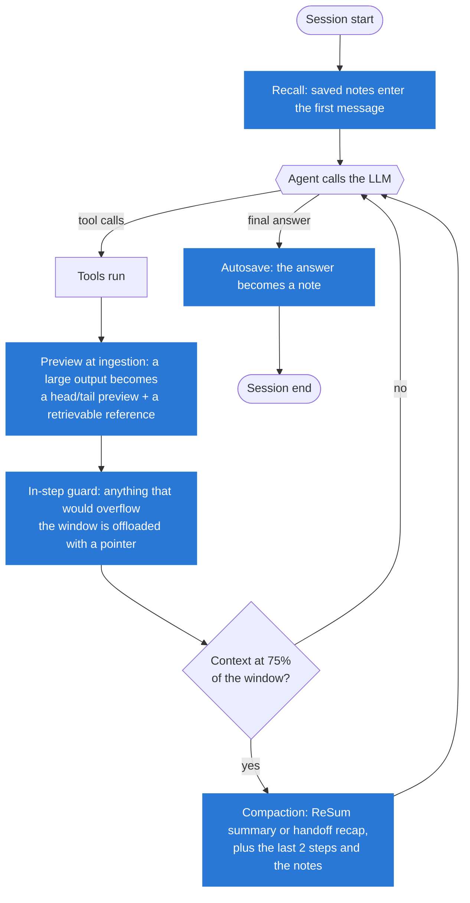
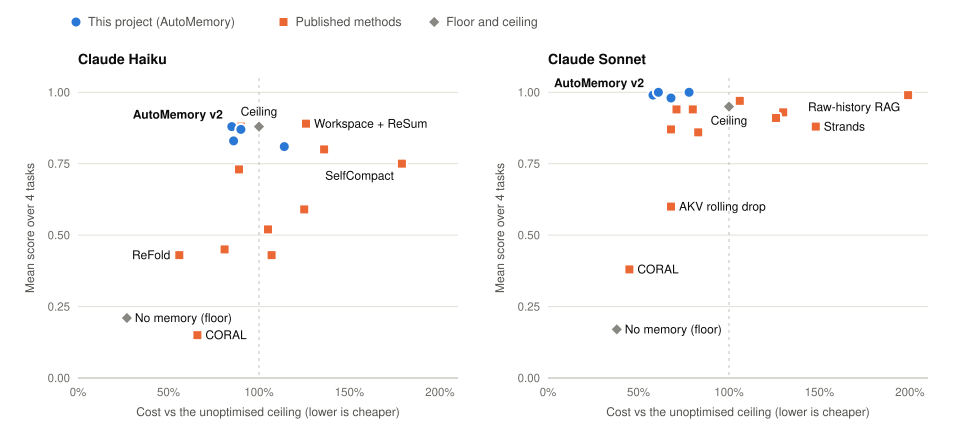
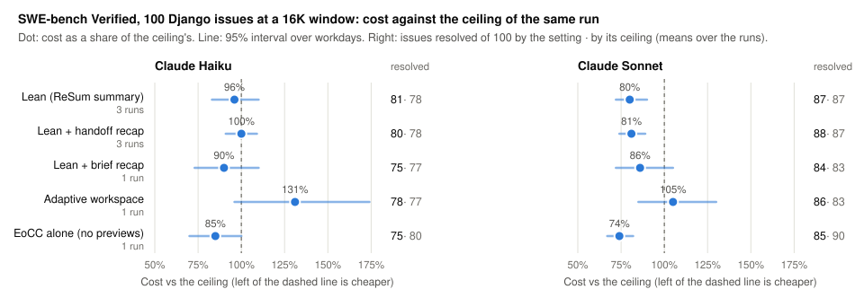
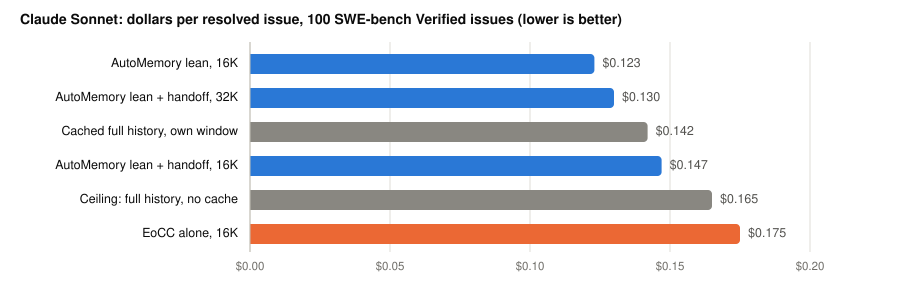
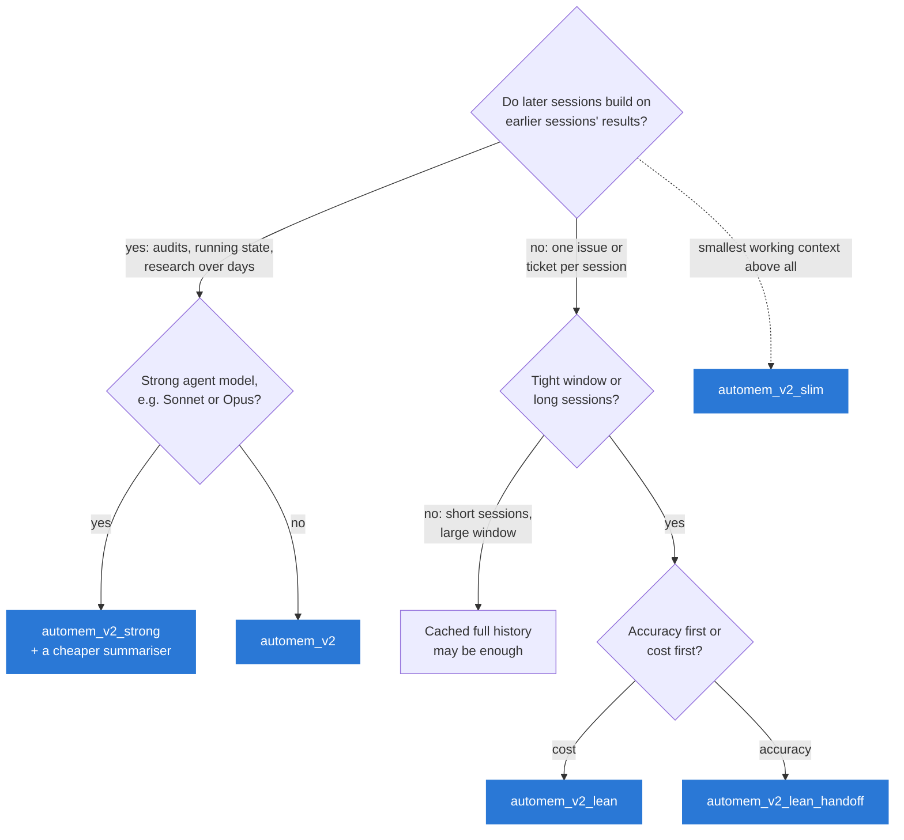
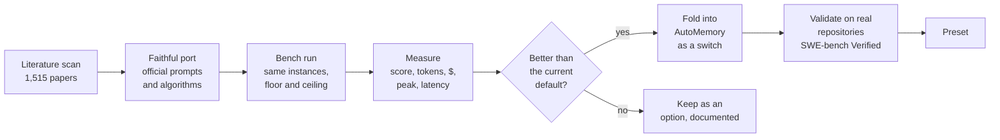
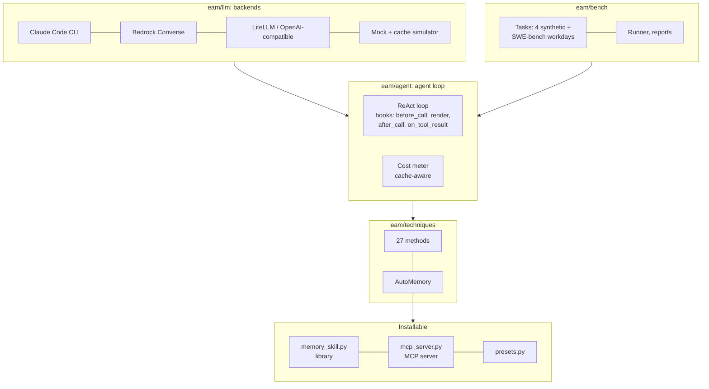

<div align="center">

# Efficient Agent Memory

**Fewer tokens, lower cost, same accuracy for long-running LLM agents.**

A measured, open test bench for agent memory and context-window techniques, and **AutoMemory**: an installable memory
layer, built from the methods that measured best, for agents on Amazon Bedrock, the Claude Code CLI or any
OpenAI-compatible endpoint.

[](LICENSE)
[](pyproject.toml)
[](tests)
[](#results)
[](#real-repositories-swe-bench-verified)
[](#mcp-server)

[Results](#results) · [How it works](#how-automemory-works) · [Which preset?](#which-preset-should-i-use) ·
[Quick start](#quick-start) · [Claude Code plugin](#claude-code-plugin) · [Methods](#methods-tested) · [Interactive overview](docs/overview.html) ·
[Contributing](#contributing)

</div>

---

## Highlights

| | |
|---|---|
| 🎯 **Ceiling accuracy below its cost** | AutoMemory v2 matches the unoptimised agent's accuracy on four long tasks at **85%** (Claude Haiku) and **58%** (Claude Sonnet) of its cost. |
| 🧪 **27 methods and variants, measured the same way** | Faithful ports of published methods (ReSum, AgentDiet, ReFold, SJC, CADOC, AKV, CORAL, SelfCompact, NVIDIA EoCC, MemoryOS, LightMem, Nemori, …), each placed between the same floor and ceiling. |
| 🛠️ **Real repositories** | On 100 SWE-bench Verified Django issues, `automem_v2_lean` costs **$0.123 per resolved issue** on Sonnet (ceiling: $0.165); with NVIDIA's handoff recap it reaches the ceiling's accuracy. |
| 📦 **Installable** | One memory layer, four ways: a bench technique, a framework-agnostic Python library, an MCP server, and a Claude Code plugin. |

> **The core lesson:** fewer tokens is not fewer dollars. Re-sent history is cheap while it stays in the prompt cache
> (0.05–0.1× the input price); rewriting it is billed as cache writes (1.25–2×). The methods that pay off act at
> ingestion or at rare resets, and let the harness, not the model, do the remembering.

---

## How AutoMemory works

AutoMemory acts at the four points of an agent loop where context can be saved, and never edits cached history every
step:



| Component | Switch | What it does | Evidence |
|---|---|---|---|
| Note workspace + recall + autosave | `workspace`, `recall`, `autosave` | Notes outlive the conversation and come back by themselves | Beat MemoryOS, LightMem and Nemori by 0.2–0.5 in score |
| Previews at ingestion | `ingest=0.1` | Outputs above 10% of the window enter as a head/tail preview | Haiku 11/16 runs solved vs 7/16, same cost |
| In-step guard | `guard=0.9` | A step of many tool calls cannot overflow the window | Removed the overflows of parallel tool calls |
| Compaction | `compact=resum\|handoff\|sjc\|…`, `trigger=0.75` | One reset at 75% of the window, keeping the last two steps | Without it: 0.04–0.62 in score |

---

## Results

About **2,800 benchmark runs** on Claude Haiku and Claude Sonnet (Claude Code CLI route, list prices, prompt caching
on), measured up to 2026-11-06.

**Measurement** (details in [`docs/methodology.md`](docs/methodology.md)):
- Each method sits between the same model's **floor** (`naive`: no memory, no caching, the task's window) and
  **ceiling** (`naive@native`: nothing removed, the model's own window, no caching), on the same task instances.
- **Cost** is relative to the ceiling's cost (60% means 40% cheaper). **Peak** is the largest prompt sent.
- Haiku 4 runs per cell, Sonnet 2–4. Differences under about 0.1 in score or 15 points in cost are within
  run-to-run noise.

### Four long synthetic tasks

<picture>
  <source media="(prefers-color-scheme: dark)" srcset="docs/assets/synthetic-frontier-dark.svg">
  
</picture>

Top left is best: the ceiling's accuracy at a fraction of its cost.

| Task | Sessions | Window | Work |
|---|---|---|---|
| `research_corpus` | 1 | 40K | multi-hop research over 130 documents |
| `ops_stream` | 10 | 32K | stock keeping with corrections across sessions |
| `ledger_audit` | 3 | 48K | data larger than the window |
| `repo_debug` | 2 | 16K | debugging a generated library with real `pytest` |

<details>
<summary><b>Full table</b>: score · cost vs ceiling · runs fully solved · peak context vs ceiling</summary>

| Method | Developer | Haiku | Sonnet |
|---|---|---|---|
| No memory (floor) | — | 0.21 · 27% · 1/16 · 34% | 0.17 · 38% · 1/16 · 48% |
| Unoptimised ceiling | — | 0.88 · 100% · 9/16 · 100% | 0.95 · 100% · 12/16 · 100% |
| Workspace + ReSum (best phase-1 combination) | USTC / Alibaba Tongyi | 0.89 · 126% · 11/16 · 40% | 0.94 · 71% · 8/10 · 42% |
| MemoryOS / LightMem / Nemori + ReSum (3 tasks) | BUPT+Tencent / ZJU / Fudan+Shanda | 0.54–0.61 · 116–184% | — |
| Strands harness defaults | AWS | 0.59 · 125% · 7/16 · 35% | 0.88 · 148% · 4/8 · 43% |
| CADOC | SJTU | 0.43 · 107% · 5/16 · 44% | 0.86 · 83% · 4/8 · 40% |
| ReFold | UCSB + Intel | 0.43 · 56% · 3/16 · 41% | 0.97 · 106% · 7/8 · 38% |
| SJC on ReSum | University of Virginia | 0.80 · 136% · 7/16 · 42% | 0.94 · 80% · 7/8 · 40% |
| OpenClaw + SJC | University of Virginia | 0.88 · 90% · 10/16 · 39% | 0.87 · 68% · 5/8 · 39% |
| AKV rolling drop | Tsinghua + CUHK | 0.45 · 81% · 4/16 · 39% | 0.60 · 68% · 3/8 · 43% |
| Raw-history RAG (3 tasks) | Memory Tax studies | 0.52 · 105% · 1/12 · 41% | 0.99 · 199% · 4/6 · 48% |
| CORAL (prompting-only) | CUHK + Tencent + HKUST | 0.15 · 66% · 0/16 · 46% | 0.38 · 45% · 1/8 · 48% |
| SelfCompact | Apple + JHU | 0.75 · 179% · 6/16 · 38% | 0.93 · 130% · 6/8 · 30% |
| EoCC handoff compaction alone (`eocc`) | NVIDIA | 0.73 · 89% · 6/16 · 42% | 0.91 · 126% · 9/16 · 46% |
| AutoMemory v1 | this repo | 0.83 · 86% · 7/16 · 34% | 0.98 · 68% · 14/16 · 36% |
| **AutoMemory v2** (`automem_v2`) | this repo | **0.88 · 85% · 11/16** · 35% | 0.99 · **58%** · 13/16 · 37% |
| **AutoMemory v2 strong** (`automem_v2_strong`) | this repo | 0.81 · 114% · 7/16 · 35% | **1.00 · 61% · 16/16** · 37% |
| AutoMemory v2 slim (`automem_v2_slim`) | this repo | 0.87 · 90% · 6/16 · **30%** | 1.00 · 78% · 7/8 · **30%** |
| AutoMemory v2 + handoff recap (`compact=handoff`) | this repo + NVIDIA | 0.83 · 79% · 8/16 · 35% | 1.00 · 66% · 13/16 · 37% |
| … recap written by the Haiku summariser (`compact=handoff_aux`) | this repo + NVIDIA | — | 0.99 · 58% · 12/16 · 38% |

- On Sonnet, AutoMemory uses Haiku as its summariser.
- Phase-1 methods tested on earlier tasks are left out: observation masking cost up to 608%, AgentDiet 410%, and
  turn control had no effect. Context-Folding solved Sonnet `research_corpus` at 20% but failed `ops_stream` and
  `ledger_audit`.

</details>

### Real repositories: SWE-bench Verified

**100 real Django issues** (SWE-bench Verified, Django 4.0–5.0, all difficulties) in 20 workdays of 5 consecutive
sessions. Each session starts from a fresh checkout at its issue's commit. Grading follows SWE-bench: the test modules
the issue's test patch touches are run, and the issue is resolved iff every FAIL_TO_PASS and PASS_TO_PASS test passes.
Windows follow NVIDIA's "You don't need long context": 16K (compaction at 12K) and 32K (at 24K).

<picture>
  <source media="(prefers-color-scheme: dark)" srcset="docs/assets/swe-16k-dark.svg">
  
</picture>

<picture>
  <source media="(prefers-color-scheme: dark)" srcset="docs/assets/swe-dollars-dark.svg">
  
</picture>

<details>
<summary><b>Full table</b>: issues resolved of 100 · cost vs ceiling · $ per resolved issue</summary>

| Setting | Window | Haiku | Sonnet |
|---|---|---|---|
| Ceiling: full history, no cache | own | 82 · 100% · $0.015 | 88 · 100% · $0.165 |
| Full history, cached (no memory layer) | own | 79 · 86% · $0.013 | 86 · 84% · $0.142 |
| Full history, cached | 32K | 77 · **62%** · **$0.010** | 87 · 100% · $0.168 |
| AutoMemory v2 lean (`automem_v2_lean`) | 32K | 78 · 98% · $0.015 | 87 · 92% · $0.154 |
| AutoMemory v2 lean + handoff (`automem_v2_lean_handoff`) | 32K | 77 · 87% · $0.014 | **89 · 79% · $0.130** |
| EoCC alone (`eocc`) | 32K | 82 · 88% · $0.013 | 84 · 87% · $0.151 |
| AutoMemory v2 lean | 16K | 76 · 83% · $0.013 | 86 · **73% · $0.123** |
| **AutoMemory v2 lean + handoff** | 16K | **81** · 89% · $0.013 | **88** · 89% · $0.147 |
| … recap written by the Haiku summariser | 16K | — | 86 · 90% · $0.152 |
| EoCC alone | 16K | 72 · 93% · $0.016 (15 overflows) | 83 · 100% · $0.175 (7 overflows) |

- At 32K the window rarely binds (sessions peak at 16–21K; 3–9 compactions in 100 issues), so the settings there
  are within noise of each other.
- At 16K, paired by issue, handoff resolves 7 issues that ReSum misses and misses 2 that it resolves (Haiku); 3 and
  1 (Sonnet). The direction is consistent but not yet certain.
- An earlier 40-issue run graded only the tests whose ids name a test method (63% of the official tests); it is
  superseded by this table.

</details>

### What the results show

1. **Fewer tokens is not fewer dollars.** Methods that edit history every step cost more than they save: AKV
   rolling drop on Sonnet `research_corpus` costs 93% when it drops every turn and 22% when it drops in blocks of 8,
   at the same score.
2. **Let the harness do the remembering.** Previews at ingestion, automatic recall and compaction at a fixed trigger
   held up on both models. Methods that need the model to manage its own memory failed on the weaker one: CORAL's
   tools were barely used, ReFold's Haiku recovery was 0.25.
3. **Plain notes beat engineered memory systems.** MemoryOS, LightMem and Nemori scored 0.2–0.5 lower than a note
   workspace with the same compaction.
4. **On coding work under a tight window, the handoff recap beats a generic summary.** Applied changes, dead ends
   and the next command are what a coding session needs after a reset: at 16K it brings both models to the
   ceiling's accuracy or within one issue of it, for 6–16 points more cost. NVIDIA's method on its own, without
   AutoMemory's guard, previews and notes, overflowed the window and resolved the fewest issues.
5. **Match the memory layer to the work.** The note workspace is essential when sessions build on earlier results
   and pure overhead (about 50% more tool calls) when they are independent.

---

## Which preset should I use?



| Preset | Spec | For |
|---|---|---|
| `automem_v2` | `automem:ingest=0.1` | The default: multi-session work that builds on earlier results |
| `automem_v2_strong` | `automem:ingest=0.1,compact=sjc` | Strong agent models, with a cheaper summariser (`#aux=`) |
| `automem_v2_slim` | `automem:ingest=0.1,fold=true` | The smallest working context |
| `automem_v2_lean` | `automem:workspace=false,ingest=0.1` | Independent tasks (coding issues, tickets), cost first |
| `automem_v2_lean_handoff` | `…,compact=handoff,handoff_variant=swe` | Independent tasks, accuracy first under a tight window |

---

## Quick start

### Benchmark with your Claude Code CLI (no Bedrock needed)

```bash
git clone https://github.com/GaryTang32/Efficient-Agent-Memory && cd Efficient-Agent-Memory
python -m venv .venv && .venv/bin/pip install pytest
.venv/bin/python -m eam.smoke --route claude-cli --model cc-haiku
.venv/bin/python -m eam.bench run --task needle_research -t full -t offload -t automem_v2 \
    --backend claude-cli --model cc-haiku --aux-model cc-haiku --n 1
```

### Offline (mock backend with a prompt-cache simulator)

```bash
python -m venv .venv && .venv/bin/pip install pytest boto3
.venv/bin/python -m pytest -q
.venv/bin/python -m eam.bench run --task needle_research -t full -t cache_layout --n 2
```

### On Amazon Bedrock

Copy `config/models.example.json` to `config/models.json`, fill in model ids and prices, then:

```bash
python -m eam.bench suite individual --backend converse --model sonnet --aux-model haiku
```

Other routes: `--backend litellm`, `mantle` or `bedrock-openai` ([`docs/backends.md`](docs/backends.md)).

### Use AutoMemory in your own agent

```python
from eam.memory_skill import MemorySkill

skill = MemorySkill("~/.eam-memory/my-project", window=200_000, summarize=cheap_llm)
messages = [{"role": "system", "content": BASE_SYSTEM + "\n\n" + skill.system_addendum()},
            {"role": "user", "content": skill.session_preamble() + task}]
tools = my_tools + skill.tool_specs()            # write_note, read_notes, read_artifact

# inside the loop, for each step:
skill.start_step(usage.prompt_tokens, reply.text)
text = skill.ingest_tool_output(name, raw_output)            # previews + in-step guard
messages = skill.maybe_compact(messages, context_tokens=skill.end_step(), question=task)
# at the end of the session:
skill.save_session(final_answer)
```

`MemorySkill(..., compaction="handoff")` switches to NVIDIA's handoff recap (`handoff_prompt()` / `apply_handoff()`).
Full loop: [`docs/automem.md`](docs/automem.md).

### MCP server

Add to `.mcp.json` (Claude Code) or your MCP client's configuration:

```json
{"mcpServers": {"automem": {"command": "python", "args": ["-m", "eam.mcp_server"],
                            "env": {"EAM_MEMORY_DIR": "/path/to/project-memory", "EAM_MEMORY_WINDOW": "200000"}}}}
```

Tools: `recall`, `write_note`, `read_notes`, `save_session`, `offload`, `read_artifact`, `context_budget`, `compact`,
`handoff`.

---

## Claude Code plugin

[`plugins/automem`](plugins/automem) runs the measured harness steps as Claude Code hooks. It makes no extra model calls,
never rewrites cached history, and leaves your permission rules alone.

```bash
claude --plugin-dir plugins/automem
```

| Hook | What it does |
|---|---|
| `PostToolUse` (Bash) | Long output reaches the model as head + tail. When Claude Code has cut the output to its own head-only preview, the tail is read from Claude Code's saved copy, so test summaries and failures at the end stay visible. |
| `PreCompact` | Compaction keeps NVIDIA's six-field handoff recap. |
| `SessionStart` | Recalls this project's notes at startup, resume, `/clear` and after compaction. |
| `Stop` | Saves each turn's final message as a project note. |

**Pilot inside Claude Code** (headless Claude Code with its own tools, 20 SWE-bench Verified issues per model, same
prompt and spending cap, with and without the plugin):

| | Resolved | Cost | Long outputs previewed |
|---|---|---|---|
| Haiku: plain / plugin | 16 / 16 | $0.115 / $0.121 (+5%) | — / 3 |
| Sonnet: plain / plugin | 15 / 16 | $1.288 / $1.153 (−10%) | — / 0 |

The plugin is neutral on short sessions: same accuracy, cost within ±10%, no errors. Claude Code solved most issues in
4–6 turns with prompts of 37–41K tokens (mostly its own instructions), so long outputs were rare; Sonnet's 10% saving
came with no preview fired and is run-to-run variation. The plugin's benefit is untested on long sessions (several
issues in one session, full test modules, compaction), which is the next pilot.

---

## Methods tested

Every technique follows its official code or prompts where they exist, and each module's docstring lists its
deviations. Each carries a provenance label (official, ported, baseline, provisional) in
[`eam/techniques/__init__.py`](eam/techniques/__init__.py).

| Family | Methods (spec) | Source |
|---|---|---|
| Compaction | ReSum (`resum`), SJC + OpenClaw (`sjc`, `openclaw`), SelfCompact (`selfcompact`), **EoCC handoff** (`eocc`) | Alibaba Tongyi, UVA, Apple + JHU, NVIDIA |
| History editing | Observation masking (`obs_mask`), AgentDiet (`agentdiet`), AKV rolling drop (`akv_drop`), ReFold (`refold`), CADOC (`cadoc`) | NeurIPS'25 DL4Code, PKU + ByteDance, Tsinghua + CUHK, UCSB + Intel, SJTU |
| Ingestion | Strands harness defaults (`strands`), tool-result offload (`offload`) | AWS, Manus rules |
| Sub-agents and loops | Context-Folding (`folding`), turn control (`turn_control`), CORAL (`coral`) | ByteDance Seed, ByteDance, CUHK + Tencent + HKUST |
| Long-term memory | Note workspace (`fs_workspace`), raw-history RAG (`raw_rag`), MemoryOS / LightMem / Nemori (`ext_memory`) | USTC, Memory Tax studies, BUPT + Tencent, ZJU, Fudan + Shanda |
| This project | AutoMemory v1/v2 (`automem`, presets) | — |

Literature: a sweep of 1,515 arXiv papers ([`docs/literature/2026-11-scan/`](docs/literature/2026-11-scan/)), a
verified list of papers ([`docs/literature_review.md`](docs/literature_review.md)) and deep-reading notes
([`docs/papers/`](docs/papers/)).

---

## How the research is run





---

## Repository layout

| Path | What is there |
|---|---|
| [`eam/`](eam/) | Harness: backends, agent loop with technique hooks, cost meter, techniques, tasks, library, MCP server |
| [`tests/`](tests/) | 242 offline tests, including a mock run of every method on every long task and the Claude Code plugin's hooks |
| [`plugins/automem/`](plugins/automem/) | The Claude Code plugin: hooks, skill, `/automem:handoff` |
| [`scripts/`](scripts/) | Run scripts for every experiment, SWE-bench validation, docs generators |
| [`docs/report.html`](docs/report.html) | The work report: work done, findings, results, the plugin and its pilot, to-do list ([rendered](https://claude.ai/artifact/89QC8QvXU4E3zCszkrnx2h)) |
| [`docs/overview.html`](docs/overview.html) | The interactive overview: each method's mechanism, diagrams, charts ([rendered](https://claude.ai/artifact/JVkigqm5XYpmwbN2F11xdF)) |
| [`docs/problem_statement.md`](docs/problem_statement.md) | Why this matters for everyday coding agents (Codex, Claude Code) |
| [`docs/methodology.md`](docs/methodology.md) | Tasks, environment rules, metric definitions, procedure |
| [`docs/automem.md`](docs/automem.md) | AutoMemory: bench technique, library and MCP server |
| [`docs/new_methods.md`](docs/new_methods.md) | The 2026-11 methods and NVIDIA EoCC: sources and deviations |
| [`docs/backends.md`](docs/backends.md) | Claude Code CLI, Bedrock Converse, LiteLLM, OpenAI-compatible endpoints |
| [`docs/plans/`](docs/plans/) | Plans and proposals with cost estimates |

Raw result rows, logs and detailed reports are kept out of the repository (`results/`, `docs/results/` are
git-ignored); every experiment's run script is in `scripts/`.

---

## Limitations and roadmap

- All runs use the Claude Code CLI route at list prices. **Bedrock validation** is blocked on credentials (runbook:
  `scripts/run_bedrock_validation.sh`); Codex / OpenAI pricing has not been re-priced.
- The synthetic tasks emulate small windows to create memory pressure.
- The SWE-bench set is 100 issues from one repository (Django).
- Next: a long-session pilot of the Claude Code plugin, an adaptive workspace (on only when a task refers to earlier results), and fewer agent tokens after a handoff
  reset, which is the remaining cost of the handoff recap.

---

## Contributing

Contributions are welcome: new methods, new tasks, other backends, or a re-run on your own provider and prices.

1. Open an issue describing the method or task, with its source (paper, repository, licence).
2. Implement a technique in `eam/techniques/` with its source and deviations in the docstring, register it in
   `eam/techniques/__init__.py`, and add a mock-backend test in `tests/`.
3. Run `.venv/bin/python -m pytest -q` (offline, no API keys needed) and open a pull request with the measured cells
   and the command that produced them.

See [`CONTRIBUTING.md`](CONTRIBUTING.md) for the rules on faithfulness and measurement.

## Citation

If this bench or AutoMemory helps your work, please cite it (see [`CITATION.cff`](CITATION.cff)):

```bibtex
@software{efficient_agent_memory,
  author = {Tang, Gary},
  title  = {Efficient Agent Memory: a measured test bench and memory layer for long-running LLM agents},
  year   = {2026},
  url    = {https://github.com/GaryTang32/Efficient-Agent-Memory}
}
```

## License

[MIT](LICENSE). Vendored third-party code and quoted prompts keep their own licences, listed in
[`eam/techniques/third_party/NOTICE.md`](eam/techniques/third_party/NOTICE.md).

## Acknowledgements

The methods measured here come from their authors' papers and repositories, credited in each technique module and
in [`docs/literature_review.md`](docs/literature_review.md). SWE-bench Verified is by Jimenez et al. (ICLR 2024) and
OpenAI; the Django test runs use the Django project's own test suite.
