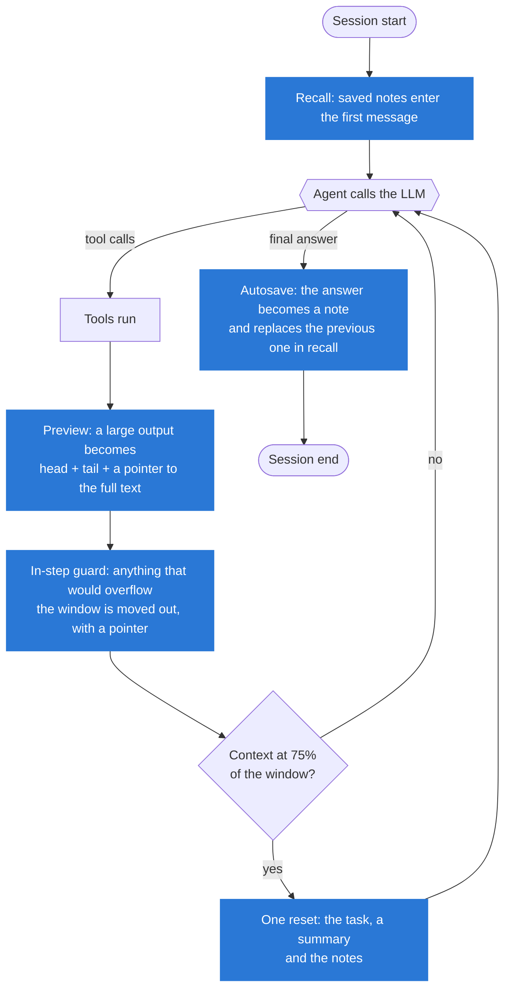
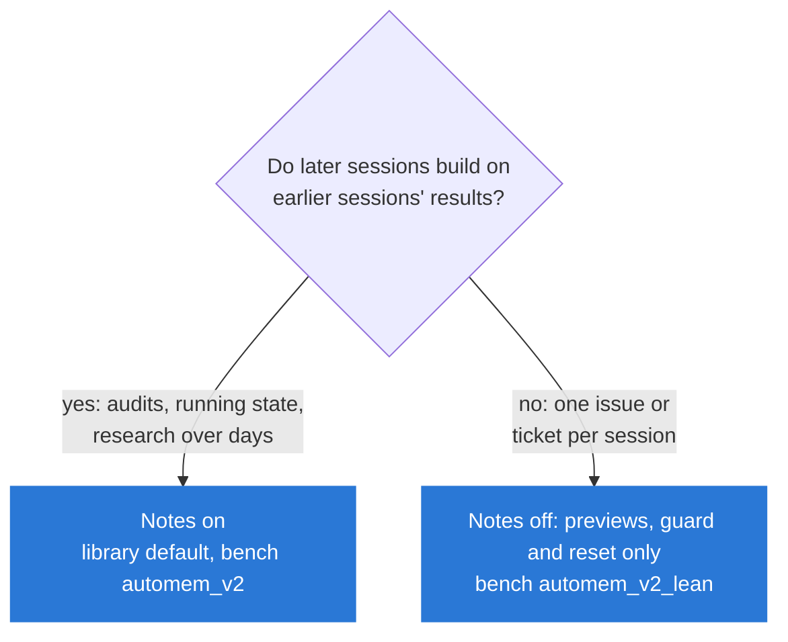
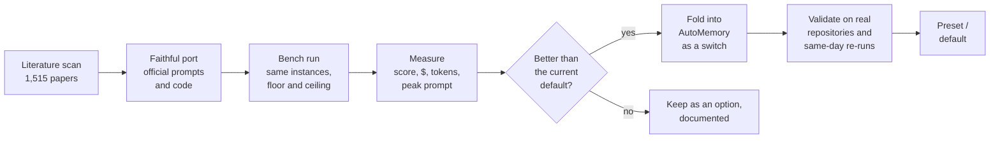

<div align="center">

# Efficient Agent Memory

**Fewer tokens, lower cost, same accuracy for long-running LLM agents.**

**AutoMemory** is a drop-in memory layer for LLM agents. It recalls what earlier sessions learned, keeps large tool
outputs out of the prompt, and resets the context once instead of trimming it every step. It is built from the
methods that measured best on an open **test bench** (`eam`), which this repository also contains.

[](LICENSE)
[](pyproject.toml)
[](CHANGELOG.md)
[](tests)
[](pyproject.toml)
[](docs/results.md)

[What it does](#what-this-repo-does) · [Install](#install) · [Quick start](#quick-start-pick-your-agent) ·
[How it works](#how-automemory-works) · [Methodology](#methodology) · [Results](#results-at-a-glance) ·
[Use the bench](#use-the-bench-eam) · [Security](#security) · [Roadmap](#roadmap)

</div>

---

## What this repo does

<picture>
  <source media="(prefers-color-scheme: dark)" srcset="docs/assets/overview-dark.svg">
  
</picture>

An agent re-sends its whole history on every call. Long tasks therefore get expensive, then fail when the context
window fills, and each new session starts from zero. The repository has two parts:

| Part | What it is | Who it is for |
|---|---|---|
| **AutoMemory** | A memory layer you add to your agent: a Python library, framework adapters, an MCP server and a Claude Code plugin. Standard library only | Anyone running LLM agents who wants lower cost per task |
| **The bench** (`eam`) | A harness that runs 27 published memory and context methods on the same tasks, models and prices, between a fixed floor and ceiling | Anyone who wants to measure a method, or re-run these results on their own provider |

> **The core lesson:** fewer tokens is not fewer dollars. Re-sent history is cheap while it stays in the prompt cache
> (0.05–0.1× the input price), and rewriting it is billed as cache writes (1.25–2×). The methods that pay off act
> when an output arrives or at a rare reset, and let the harness, not the model, do the remembering.

---

## Install

Python 3.10 or later. The core has no runtime dependencies; each framework adapter installs its framework as an
extra.

```bash
pip install "efficient-agent-memory @ git+https://github.com/GaryTang32/Efficient-Agent-Memory"

# with a framework adapter (pick one or more)
pip install "efficient-agent-memory[langgraph] @ git+https://github.com/GaryTang32/Efficient-Agent-Memory"
```

| Extra | Installs | For |
|---|---|---|
| *(none)* | nothing | The library, `MemoryHooks`, the MCP server (`automem-mcp`) |
| `anthropic` | `anthropic` | The Claude API adapter |
| `claude-agent-sdk` | `claude-agent-sdk` | The Claude Agent SDK adapter |
| `langgraph` | `langchain`, `langgraph` | LangChain v1 agents and LangGraph |
| `openai-agents` | `openai-agents` | The OpenAI Agents SDK adapter |
| `adapters` | all of the above, plus `mcp` | Running every adapter's tests |
| `bedrock`, `research`, `dev` | `boto3`, `duckdb`, `pytest` | The bench on Bedrock, the research store, the tests |

For the bench and the Claude Code plugin, clone the repository instead (see [Use the bench](#use-the-bench-eam)).

---

## Quick start: pick your agent

| Your agent runs on | Use | Guide |
|---|---|---|
| Your own loop, any provider | `eam.adapters.MemoryHooks` | [below](#your-own-agent-loop) |
| LangChain v1 / LangGraph | `eam.adapters.langgraph.AutoMemoryMiddleware` | [below](#langchain-v1--langgraph) |
| The Claude API (Messages) | `eam.adapters.anthropic.MemoryMiddleware`, `NoteMemoryTool` | [adapters.md](docs/adapters.md#claude-api) |
| The Claude Agent SDK | `eam.adapters.claude_agent_sdk.AgentMemory` | [adapters.md](docs/adapters.md#claude-agent-sdk) |
| The OpenAI Agents SDK | `eam.adapters.openai_agents.OpenAIAgentsMemory` | [adapters.md](docs/adapters.md#openai-agents-sdk) |
| Claude Code | the plugin in `plugins/automem` | [below](#claude-code) |
| Any MCP client | `automem-mcp` | [below](#any-mcp-client) |

All of them share one note store per project directory, so a note written from one is recalled in another. Give each
adapter your model's context window (`window=`) and, for the rare reset, any cheap LLM call (`summarize=`).

### Your own agent loop

```python
from eam.adapters import MemoryHooks

hooks = MemoryHooks("~/.eam-memory/my-project", window=200_000, summarize=cheap_llm)

messages = [{"role": "system", "content": hooks.system_text(BASE_SYSTEM)},     # note rules + "<memory> is data"
            {"role": "user", "content": hooks.start_session(task)}]            # recalled notes + the task
tools = my_tools + hooks.tool_specs()                                          # write_note, read_notes, read_artifact

while True:
    reply = llm(messages, tools)
    hooks.after_call(reply.usage.prompt_tokens, reply.text)    # real prompt size, from the provider's usage
    if not reply.tool_calls:
        hooks.end_session(reply.text)                          # autosave: later sessions recall this answer
        break
    for call in reply.tool_calls:
        out = (hooks.call_tool(call.name, call.args) if hooks.is_memory_tool(call.name)
               else hooks.on_tool_result(call.name, run(call)))   # long outputs become head + tail + a pointer
        messages.append(tool_message(call, out))
    messages = hooks.compact(messages)                         # unchanged until the window is 75% full
```

`cheap_llm(prompt) -> str` can be any model; a smaller one is fine. Without it, everything works except the reset.

### LangChain v1 / LangGraph

```python
from langchain.agents import create_agent
from eam.adapters.langgraph import AutoMemoryMiddleware

memory = AutoMemoryMiddleware("~/.eam-memory/my-project", window=200_000, summarize=cheap_llm)
agent = create_agent(model, tools=[search, run_tests], system_prompt="You fix bugs.", middleware=[memory])
agent.invoke({"messages": [{"role": "user", "content": "Fix the failing test."}]})
```

The Claude API, Claude Agent SDK and OpenAI Agents SDK work the same way: one object, a few lines
([docs/adapters.md](docs/adapters.md)).

### Claude Code

```bash
git clone https://github.com/GaryTang32/Efficient-Agent-Memory
claude --plugin-dir Efficient-Agent-Memory/plugins/automem
```

The plugin recalls the project's notes at session start, previews long Bash output (head and tail), keeps a handoff
recap when Claude Code compacts, and saves each turn's final message. It makes no extra model calls. Inside Claude
Code it was neutral in the pilots (same accuracy, cost within ±10%), because Claude Code already caches, compacts and
saves long outputs. The layer pays off most in agents without those built-ins and in multi-session work.

### Any MCP client

```json
{"mcpServers": {"automem": {"command": "automem-mcp",
                            "env": {"EAM_MEMORY_DIR": "/path/to/project-memory", "EAM_MEMORY_WINDOW": "200000"}}}}
```

Tools: `recall` (call first in each session), `write_note`, `read_notes`, `save_session`, `offload`, `read_artifact`,
`context_budget`, `compact` and `handoff`. An MCP server cannot rewrite its client's context, so the client applies
resets itself.

---

## How AutoMemory works

AutoMemory acts at the points of an agent loop where context can be saved, and never edits cached history at every
step:



| Step | What it does | Why (measured) |
|---|---|---|
| **Notes + recall + autosave** | The agent keeps notes with `write_note`; they come back by themselves in the next session; each answer is saved, and only the newest is recalled | Plain notes beat MemoryOS, LightMem and Nemori by 0.2–0.5 in score; recalling only the newest answer cut Sonnet's notes from 26% to 16% of the prompt |
| **Preview at ingestion** | An output above 10% of the window enters as head + tail; the full text is stored and paged with `read_artifact` | Without it, NVIDIA's recap alone ran out of window in about 1 session in 5 and resolved 5 fewer of 100 Django issues |
| **In-step guard** | A step of many tool calls cannot push the next prompt past 90% of the window | Removed the overflows of parallel tool calls |
| **One reset at 75%** | ReSum's summary (or NVIDIA's handoff recap) replaces the history once | Methods that trim every step cost up to 6× more: they break the prompt cache |
| **Safety** | Recalled text is marked as data; secrets are redacted before saving; files are owner-only | 0 of 20 planted instructions obeyed (4 of 20 unwrapped) |

### Which setting for which work



Notes matter when sessions reuse what earlier ones learned (running totals, an audit over rounds): without them,
scores dropped by about 0.1 at 1.5–2.5× the cost. On independent coding issues they are overhead (Haiku: twice the
cost, fewer issues resolved). When unsure, keep notes on. The full preset family and every switch are in
[`docs/automem_v2.md`](docs/automem_v2.md).

| Setting | Default | Effect |
|---|---|---|
| `window` | 200,000 | Your model's context window, in tokens; every threshold is a share of it |
| `summarize` | none | Any LLM call `str -> str` for the reset; a cheaper model is fine |
| `preview` | 0.1 | Outputs above this share of the window enter as head + tail (0 turns it off) |
| `guard` | 0.9 | Share of the window one step may fill before outputs are moved out |
| `trigger` | 0.75 | Share of the window at which the one reset happens |
| `recall_budget` | 0.1 | Recalled notes take at most this share of the window |
| `compaction` | `resum` | `resum` or `handoff` (NVIDIA's six-field recap) |
| `store` | JSON files | `SQLiteStore(path)` for many notes or concurrent writers, `MemoryStore()` for short-lived agents |
| `compact_at` | — | The reset point in tokens instead of a share: `window=1_000_000, compact_at=400_000` resets at 400K |
| `preview_max_tokens` | 16,000 | Caps the preview threshold, so large windows still preview long outputs (at 1M, 10% alone would let 100K-token outputs in whole); it only matters above a 160K window |

Settings can change per session: `hooks.start_session(task, compact_at=200_000)` or `hooks.next_session(...)` (works
with every adapter); a session that sets nothing uses the defaults. For 1M-token models, see
[large context windows](docs/adapters.md#large-context-windows-and-per-session-settings).

---

## Methodology

The question for every method is the same: **does it keep the full-context agent's accuracy at a lower cost?**



1. **Faithful ports.** Each method follows its official code or prompts where they exist; each module's docstring
   lists its deviations.
2. **Floor and ceiling.** Every method runs between the same model's floor (`naive`: no memory, no caching) and
   ceiling (`naive@native`: nothing removed, the model's own window), on the same task instances.
3. **Tasks that need memory.** Four long synthetic tasks (multi-hop research over 130 documents, ten days of stock
   keeping with corrections, an audit larger than the window, debugging with real `pytest`) and SWE-bench Verified
   issues from Django and SymPy, run as workdays of five sessions inside a 16K window and graded as SWE-bench grades
   them.
4. **Cost as billed.** Cache-aware cost at list prices: cache reads at 0.1×, writes at 1.25–2×. Results are reported
   as a share of the ceiling's cost, with the score, the runs fully solved and the peak prompt.
5. **Noise before rankings.** The same setting was run twice on one day to measure the spread: up to 0.11 in score
   on the synthetic tasks, and 1–2 issues and 7–38% in cost on 100 coding issues. A validation round re-ran every
   decision on one day, had the measurement code audited, added a second repository, and withdrew four claims.
6. **Traces and invariants.** Every run writes a trace (calls, tool calls, events, grades); a research store checks
   invariants such as "cost equals the sum of its parts" on every row.

Models: Claude Haiku and Claude Sonnet through the Claude Code CLI, about 3,700 runs. Full procedure and metric
definitions: [`docs/methodology.md`](docs/methodology.md).

---

## Results at a glance

| Workload | Result |
|---|---|
| **Four long synthetic tasks** | AutoMemory v2 matches the ceiling's accuracy at **85%** (Haiku) and **58%** (Sonnet) of its cost, with about 35% of its peak prompt. A same-day re-run gave 74–87% and 56% |
| **SWE-bench Verified, 100 Django issues, 16K window** | The lean setting resolves as many issues as the full-window ceiling; on Sonnet at **80%** of its cost over three runs (95% interval 72–90%); on Haiku at the same cost |
| **Second repository (SymPy) and related-issue workdays** | The lean result holds; notes do not pay on coding issues, even related ones |
| **Ten-day job, recall fix** | Recalling only the newest session answer cut Sonnet's notes from 26% to 16% of the prompt and Haiku's cost to 82%, with the facts each session needs still carried |
| **Inside Claude Code (plugin)** | Neutral: same accuracy, cost within ±10%, because Claude Code already caches and compacts |
| **Memory poisoning probe** | 0 of 20 planted instructions obeyed with notes marked as data (4 of 20 without) |

Every table, the validation round, the plugin pilots and the 27 methods with their papers are in
[**docs/results.md**](docs/results.md).

---

## Use the bench (`eam`)

```bash
git clone https://github.com/GaryTang32/Efficient-Agent-Memory && cd Efficient-Agent-Memory
python -m venv .venv && .venv/bin/pip install -e ".[dev]"
.venv/bin/python -m pytest -q                      # 393 offline tests, no API keys
```

**Run a comparison offline.** The mock backend simulates a model and its prompt cache, so you can try every method
without keys (costs are simulated):

```bash
.venv/bin/python -m eam.bench run --task ops_stream -t naive -t automem_v2 --n 1 --out results/try.jsonl
.venv/bin/python -m eam.bench report results/try.jsonl
```

**Run it on a real model.** Through your Claude Code CLI (no cloud account needed), or Amazon Bedrock:

```bash
.venv/bin/python -m eam.smoke --route claude-cli --model cc-haiku           # check the route works
.venv/bin/python -m eam.bench run --task ops_stream -t naive@native -t automem_v2 -t automem_v2_lean \
    --backend claude-cli --model cc-haiku --aux-model cc-haiku --n 2 --out results/ops-haiku.jsonl
.venv/bin/python -m eam.bench.analyze --summary results/ops-haiku.jsonl     # score, cost vs ceiling, rounds
```

For Bedrock, copy `config/models.example.json` to `config/models.json`, fill in model ids and prices, and use
`--backend converse`. Other routes: `litellm`, `mantle`, `bedrock-openai` ([`docs/backends.md`](docs/backends.md)).

| Concept | What to pass |
|---|---|
| **Tasks** (`--task`) | `research_corpus`, `ops_stream`, `ledger_audit`, `repo_debug` (the four long tasks), plus `needle_research`, `chain_hunt`, `inventory_ops`, `long_document_qa`, `multi_session_profile`. SWE-bench workdays: `scripts/run_swe.py` |
| **Methods** (`-t`, repeatable) | A preset (`automem_v2`, `automem_v2_lean`, ...), a method with options (`automem:ingest=0.1,guard=0`), or a combination (`cache_layout+offload`). `naive` is the floor, `naive@native` the ceiling. `#aux=cc-haiku` gives one spec a cheaper summariser |
| **Instances** (`--n`, `--seed`) | Task instances per family; every method runs on the same ones |
| **Output** (`--out`, `--resume`) | One JSON row per run, plus a gzipped trace in `results/traces/`; `--resume` skips rows already recorded |
| **Tables** | `eam.bench report` (all columns), `eam.bench.analyze --summary` / `--metrics` / `--robust` |
| **Suites** | `python -m eam.bench suite <name>`: the named grids in `eam/bench/experiments.py` |

**Add a method.** Write a `Technique` in `eam/techniques/` (hooks: `on_session_start`, `before_call`, `render`,
`after_call`, `on_tool_result`, `on_final`, `on_session_end`), note its source and deviations in the docstring, register it in
`eam/techniques/registry.py`, and add a mock-backend test. Every experiment in the repository has its run script in
`scripts/`.

---

## Repository layout

| Path | What is there |
|---|---|
| [`eam/automem/`](eam/automem/), [`eam/memory_skill.py`](eam/memory_skill.py) | AutoMemory's core: pure decision rules, typed notes, storage, the library |
| [`eam/adapters/`](eam/adapters/) | `MemoryHooks` and the adapters for the Claude API, Claude Agent SDK, LangGraph and OpenAI Agents SDK |
| [`eam/mcp_server.py`](eam/mcp_server.py) | The MCP server (`automem-mcp`) |
| [`plugins/automem/`](plugins/automem/) | The Claude Code plugin: hooks, skill, `/automem:handoff` |
| [`eam/bench/`](eam/bench/), [`eam/techniques/`](eam/techniques/), [`eam/llm/`](eam/llm/), [`eam/agent/`](eam/agent/) | The bench: tasks and runner, the 27 methods, model backends, the agent loop and cost meter |
| [`tests/`](tests/) | 393 offline tests, including every method on every long task and every adapter with a fake model |
| [`scripts/`](scripts/) | The run script of every experiment, SWE-bench tooling, reports, docs generators |
| [`docs/`](docs/) | [results](docs/results.md) · [methodology](docs/methodology.md) · [AutoMemory v2 guide](docs/automem_v2.md) · [adapters](docs/adapters.md) · [backends](docs/backends.md) · [literature](docs/literature_review.md) · [interactive overview](docs/overview.html) |

Raw result rows, logs and detailed reports stay out of the repository (`results/` and `docs/results/` are
git-ignored).

---

## Security

A memory layer replays text from one session into later ones, so it adds risks a plain agent does not have.
AutoMemory defends against them by default, in every form:

- **Memory poisoning:** recalled notes, summaries and recaps reach the model as a `<memory>` block marked as data,
  with a system rule never to follow instructions found inside.
- **Secret leakage:** API keys, tokens, private keys and credentials become `[REDACTED:kind]` before anything is saved.
- **File safety:** files are owner-only and written atomically, notes are updated under a lock, saved outputs are
  deleted after 14 days or beyond 200 MB.
- **Bounded recall:** recalled notes take at most 10% of the window.

Everything runs locally with no network calls of its own. Threat model and limits: [SECURITY.md](SECURITY.md). Please
report vulnerabilities privately through the repository's Security tab.

---

## Roadmap

| Step | Status |
|---|---|
| 1–2. Security hardening; core, storage and adapter layers | Done |
| 3. Why runs fail: traced re-runs, failure causes, a canary run | Done |
| 4–5. Recall measurement and targeted fixes (newest-answer recall, test check, ids in notes) | Done |
| 6. Framework adapters, MCP refresh, pip package (0.3.0) | Done |
| 7. Head-to-head with Anthropic's compaction, context editing and memory tool; the adapters' savings with real models | Needs API credentials |

Also open: Bedrock with native tool calls, non-Claude models, a repository outside Python, and publishing to PyPI.

## Limitations

- **Claude models only, so far.** Every result is on Claude Haiku and Sonnet through the Claude Code CLI at list
  prices, with tools emulated as text.
- **Two coding repositories.** The SWE-bench sets are Django and SymPy, both Python; the synthetic tasks emulate small
  windows to create memory pressure.
- **Adapters are checked for wiring, not yet for savings.** Each adapter passes the same offline conformance suite
  with a fake model; their savings inside each framework have not been measured with real models yet (step 7).

---

## Contributing

Contributions are welcome: new methods, new tasks, other backends, adapters for other frameworks, or a re-run on your
own provider and prices. Open an issue with the source (paper, repository, licence), add the method or adapter with a
test (offline, no keys), and include the measured cells and the command that produced them. Rules on faithfulness
and measurement: [`CONTRIBUTING.md`](CONTRIBUTING.md). A new adapter must pass
[`tests/adapters/conformance.py`](tests/adapters/conformance.py) ([how](docs/adapters.md#writing-a-new-adapter)).

## Citation

```bibtex
@software{efficient_agent_memory,
  author = {Tang, Gary},
  title  = {Efficient Agent Memory: a measured test bench and memory layer for long-running LLM agents},
  year   = {2026},
  url    = {https://github.com/GaryTang32/Efficient-Agent-Memory}
}
```

## License

[MIT](LICENSE). Vendored third-party code and quoted prompts keep their own licences, listed in
[`eam/techniques/third_party/NOTICE.md`](eam/techniques/third_party/NOTICE.md).

## Acknowledgements

The methods measured here come from their authors' papers and repositories, credited in each technique module, in
[`docs/results.md`](docs/results.md#methods-tested) and in [`docs/literature_review.md`](docs/literature_review.md).
SWE-bench Verified is by Jimenez et al. (ICLR 2024) and OpenAI; the Django test runs use the Django project's own test
suite.
