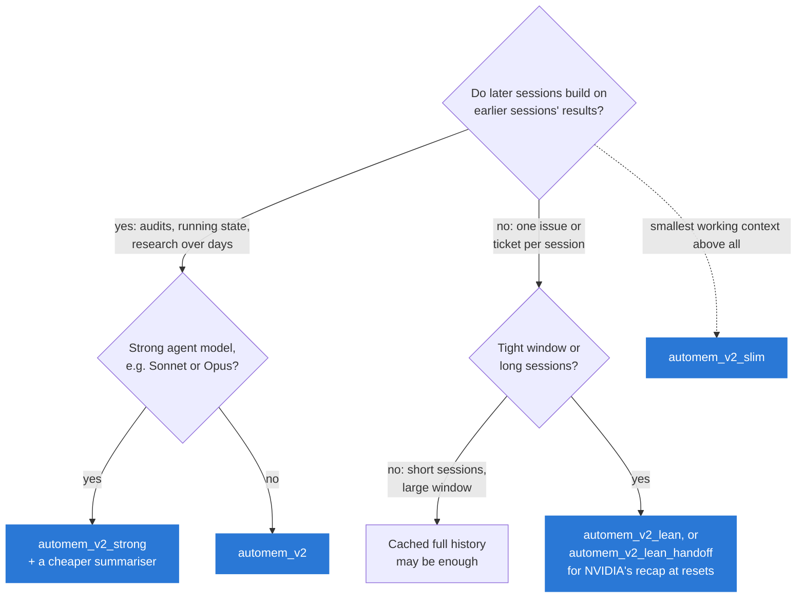
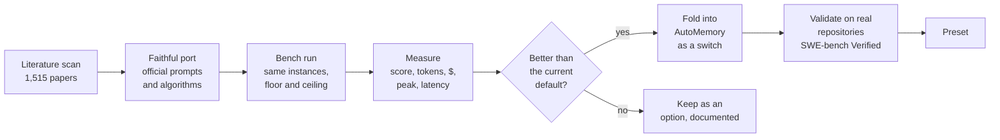
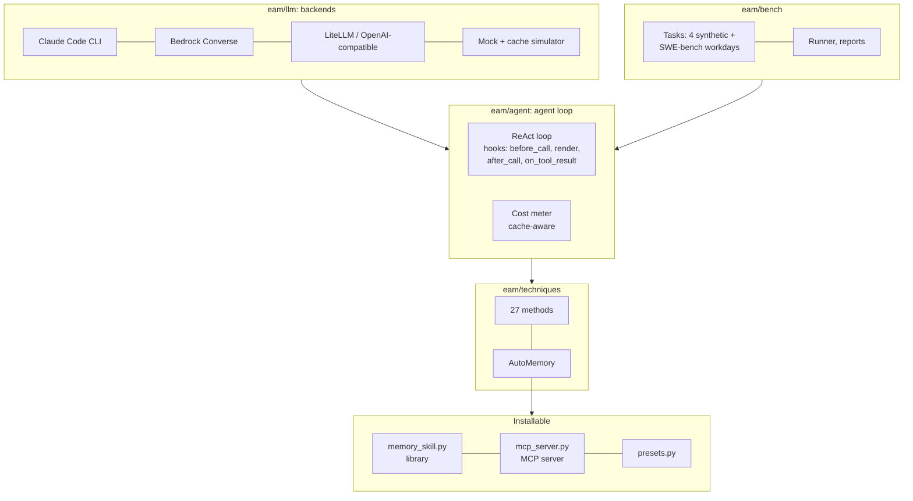

<div align="center">

# Efficient Agent Memory

**Fewer tokens, lower cost, same accuracy for long-running LLM agents.**

A measured, open test bench for agent memory and context-window techniques, and **AutoMemory**: an installable memory
layer, built from the methods that measured best, for agents on Amazon Bedrock, the Claude Code CLI or any
OpenAI-compatible endpoint.

[](LICENSE)
[](pyproject.toml)
[](tests)
[](#results)
[](#real-repositories-swe-bench-verified)
[](#mcp-server)

[Results](#results) · [How it works](#how-automemory-works) · [Which preset?](#which-preset-should-i-use) ·
[Quick start](#quick-start) · [Claude Code plugin](#claude-code-plugin) · [Methods](#methods-tested) · [Interactive overview](docs/overview.html) ·
[Contributing](#contributing)

</div>

---

## Highlights

| | |
|---|---|
| 🎯 **Ceiling accuracy below its cost** | AutoMemory v2 matches the unoptimised agent's accuracy on four long multi-session tasks at **85%** (Claude Haiku) and **58%** (Claude Sonnet) of its cost. A same-day re-run and a repeat gave 74–87% and 56%. |
| 🧪 **27 methods and variants, measured the same way** | Faithful ports of published methods (ReSum, AgentDiet, ReFold, SJC, CADOC, AKV, CORAL, SelfCompact, NVIDIA EoCC, MemoryOS, LightMem, Nemori, …), each placed between the same floor and ceiling. |
| 🛠️ **Real repositories** | On SWE-bench Verified (100 Django and 75 SymPy issues), `automem_v2_lean` resolves as many issues inside a 16K window as the unoptimised agent with its full window. On Sonnet it costs **80%** of that agent over three runs (95% interval 72–90%); on Haiku the cost is the same. |
| 🔁 **Checked twice** | A [validation round](#validation-round) re-ran every decision cell on one day, repeated cells to measure noise, audited the measurement code and added a second repository. It confirmed the two results above and withdrew four smaller claims; a follow-up with three runs per cell settled the cost question. |
| 📦 **Installable** | One memory layer, four ways: a bench technique, a framework-agnostic Python library, an MCP server, and a Claude Code plugin. |

> **The core lesson:** fewer tokens is not fewer dollars. Re-sent history is cheap while it stays in the prompt cache
> (0.05–0.1× the input price); rewriting it is billed as cache writes (1.25–2×). The methods that pay off act at
> ingestion or at rare resets, and let the harness, not the model, do the remembering.

---

## How AutoMemory works

AutoMemory acts at the four points of an agent loop where context can be saved, and never edits cached history every
step:


| Component | Switch | What it does | Evidence |
|---|---|---|---|
| Note workspace + recall + autosave | `workspace`, `recall`, `autosave` | Notes outlive the conversation and come back by themselves | Beat MemoryOS, LightMem and Nemori by 0.2–0.5 in score |
| Previews at ingestion | `ingest=0.1` | Outputs above 10% of the window enter as a head/tail preview | Haiku 11/16 runs solved vs 7/16, same cost |
| In-step guard | `guard=0.9` | A step of many tool calls cannot overflow the window | Removed the overflows of parallel tool calls |
| Compaction | `compact=resum\|handoff\|sjc\|…`, `trigger=0.75` | One reset at 75% of the window, keeping the last two steps | Without it: 0.04–0.62 in score |

---

## Results

About **3,700 benchmark runs** on Claude Haiku and Claude Sonnet (Claude Code CLI route, list prices, prompt caching
on), measured up to 2026-11-12.

**Measurement** (details in [`docs/methodology.md`](docs/methodology.md)):
- Each method sits between the same model's **floor** (`naive`: no memory, no caching, the task's window) and
  **ceiling** (`naive@native`: nothing removed, the model's own window, no caching), on the same task instances.
- **Cost** is relative to the ceiling's cost (60% means 40% cheaper). **Peak** is the largest prompt sent.
- Haiku 4 runs per cell, Sonnet 2–4. Measured run-to-run spread (the same setting twice on one day): up to 0.11 in
  mean score on the synthetic tasks; on 100 coding issues, 1–2 issues resolved and 7–38% in cost. Smaller differences
  are noise.

### Four long synthetic tasks

<picture>
  <source media="(prefers-color-scheme: dark)" srcset="docs/assets/synthetic-frontier-dark.svg">
  
</picture>

Top left is best: the ceiling's accuracy at a fraction of its cost.

| Task | Sessions | Window | Work |
|---|---|---|---|
| `research_corpus` | 1 | 40K | multi-hop research over 130 documents |
| `ops_stream` | 10 | 32K | stock keeping with corrections across sessions |
| `ledger_audit` | 3 | 48K | data larger than the window |
| `repo_debug` | 2 | 16K | debugging a generated library with real `pytest` |

<details>
<summary><b>Full table</b>: score · cost vs ceiling · runs fully solved · peak context vs ceiling</summary>

| Method | Developer | Haiku | Sonnet |
|---|---|---|---|
| No memory (floor) | — | 0.21 · 27% · 1/16 · 34% | 0.17 · 38% · 1/16 · 48% |
| Unoptimised ceiling | — | 0.88 · 100% · 9/16 · 100% | 0.95 · 100% · 12/16 · 100% |
| Workspace + ReSum (best phase-1 combination) | USTC / Alibaba Tongyi | 0.89 · 126% · 11/16 · 40% | 0.94 · 75% · 8/10 · 42% |
| MemoryOS / LightMem / Nemori + ReSum (3 tasks) | BUPT+Tencent / ZJU / Fudan+Shanda | 0.54–0.61 · 114–179% | — |
| Strands harness defaults | AWS | 0.59 · 125% · 7/16 · 35% | 0.88 · 160% · 4/8 · 43% |
| CADOC | SJTU | 0.43 · 107% · 5/16 · 44% | 0.86 · 86% · 4/8 · 40% |
| ReFold | UCSB + Intel | 0.43 · 56% · 3/16 · 41% | 0.97 · 108% · 7/8 · 38% |
| SJC on ReSum | University of Virginia | 0.80 · 136% · 7/16 · 42% | 0.94 · 81% · 7/8 · 40% |
| OpenClaw + SJC | University of Virginia | 0.88 · 90% · 10/16 · 39% | 0.87 · 69% · 5/8 · 39% |
| AKV rolling drop | Tsinghua + CUHK | 0.45 · 81% · 4/16 · 39% | 0.60 · 69% · 3/8 · 43% |
| Raw-history RAG (3 tasks) | Memory Tax studies | 0.52 · 105% · 1/12 · 41% | 0.99 · 213% · 4/6 · 48% |
| CORAL (prompting-only) | CUHK + Tencent + HKUST | 0.15 · 66% · 0/16 · 46% | 0.38 · 46% · 1/8 · 48% |
| SelfCompact | Apple + JHU | 0.75 · 179% · 6/16 · 38% | 0.93 · 134% · 6/8 · 30% |
| EoCC handoff compaction alone (`eocc`) | NVIDIA | 0.73 · 89% · 6/16 · 42% | 0.91 · 126% · 9/16 · 46% |
| AutoMemory v1 | this repo | 0.83 · 86% · 7/16 · 34% | 0.98 · 68% · 14/16 · 36% |
| **AutoMemory v2** (`automem_v2`) | this repo | **0.88 · 85% · 11/16** · 35% | 0.99 · **58%** · 13/16 · 37% |
| **AutoMemory v2 strong** (`automem_v2_strong`) | this repo | 0.81 · 114% · 7/16 · 35% | **1.00 · 61% · 16/16** · 37% |
| AutoMemory v2 slim (`automem_v2_slim`) | this repo | 0.87 · 90% · 6/16 · **30%** | 1.00 · 80% · 7/8 · **30%** |
| AutoMemory v2 + handoff recap (`compact=handoff`) | this repo + NVIDIA | 0.83 · 79% · 8/16 · 35% | 1.00 · 66% · 13/16 · 37% |
| … recap written by the Haiku summariser (`compact=handoff_aux`) | this repo + NVIDIA | — | 0.99 · 58% · 12/16 · 38% |

- On Sonnet, AutoMemory uses Haiku as its summariser.
- Cost and peak are relative to the ceiling on the same task instances (a method run on fewer instances is
  compared with the ceiling on those instances only).
- Same-day re-run of 2026-11-12 (instances 0–3, same formula): AutoMemory v2 scored 0.75 and 0.86 at 87% and 74%
  on Haiku (ceiling 0.80) and 0.99 and 1.00 at 56% on Sonnet (ceiling 0.95). Without the note workspace
  (`automem_v2_lean`) the same tasks scored 0.64 and 0.87 at 249% and 152%.
- Phase-1 methods tested on earlier tasks are left out: observation masking cost up to 608%, AgentDiet 410%, and
  turn control had no effect. Context-Folding solved Sonnet `research_corpus` at 20% but failed `ops_stream` and
  `ledger_audit`.

</details>

### Real repositories: SWE-bench Verified

Real issues from SWE-bench Verified in workdays of 5 consecutive sessions, one issue per session. Each session starts
from a fresh checkout at its issue's commit. Grading follows SWE-bench: the test files the issue's test patch touches
are run, and the issue is resolved iff every FAIL_TO_PASS and PASS_TO_PASS test passes. The memory settings work inside
a 16K window (compaction at 12K, after NVIDIA's "You don't need long context"); the ceiling keeps the full history in
the model's own window.

<picture>
  <source media="(prefers-color-scheme: dark)" srcset="docs/assets/swe-16k-dark.svg">
  
</picture>

Issues resolved · cost vs the ceiling [95% interval over workdays]. Every cell is compared with a ceiling run on the
same day (2026-11-09 to 11-13). The first three rows are three runs each: mean issues resolved, costs pooled.

| Issue set | Setting | Haiku | Sonnet |
|---|---|---|---|
| **Django**, 100 issues, **three runs** | Ceiling: full history, own window | 78 · 100% | 87 · 100% |
| | `automem_v2_lean` | 81 · 96% [83–110] | 87 · **80%** [72–90] |
| | `automem_v2_lean_handoff` | 80 · 100% [91–109] | 88 · **81%** [74–89] |
| **Django**, the same issues, one run | Ceiling | 77 · 100% | 83 · 100% |
| | … brief recap (`handoff_variant=brief`) | 75 · 90% [73–110] | 84 · 86% [72–105] |
| | `automem_v2_adaptive` | 78 · 131% [96–174] | 86 · 105% [85–130] |
| **Django**, the same issues, one run | Ceiling | 80 · 100% | 90 · 100% |
| | EoCC alone (`eocc`): handoff recap, no previews | 75 · 85% [70–100] | 85 · 74% [67–82] |
| **Django, related issues**: each workday stays in one subsystem (80 issues Haiku, 50 Sonnet) | Ceiling | 64 · 100% | 44 · 100% |
| | `automem_v2_lean` | **70** · 117% [89–152] | 44 · 95% [66–126] |
| | `automem_v2` (with notes) | 64 · 208% [169–247] | 44 · 87% [69–113] |
| | `automem_v2_adaptive` | 67 · 106% [83–135] | 45 · 80% [60–104] |
| **SymPy**, a second repository (75 issues Haiku, 40 Sonnet) | Ceiling | 50 · 100% | 35 · 100% |
| | `automem_v2_lean` | 50 · 116% [81–158] | 35 · **70%** [54–109] |
| | `automem_v2_lean_handoff` | 52 · 92% [71–123] | 34 · 74% [56–108] |

- **Accuracy.** Inside a 16K window the lean settings resolve as many issues as the ceiling in every set. Paired by
  issue, no lean setting differs significantly from the ceiling or from another lean setting (sign test, p ≥ 0.07).
- **Cost.** On Sonnet, lean costs 80% of the ceiling over three Django runs (82%, 77% and 81% run by run) and is
  below it in the other two sets. On Haiku it cannot be told apart from the ceiling (92%, 110% and 89%).
- **EoCC alone is cheap but loses issues.** Without previews at ingestion, 22 (Haiku) and 19 (Sonnet) of 100 sessions
  filled the 16K window and were stopped. It resolved 5 fewer issues than its ceiling on both models (pooled: 2 gained,
  12 lost, p = 0.013), 8 of the 12 in stopped sessions, at 85% and 74% of the ceiling's cost.
- **Notes do not pay on coding issues**, even when consecutive issues touch the same subsystem: with the note
  workspace Haiku resolved 64 instead of 70 at almost twice the cost, and later sessions of a workday gained nothing.
- **Handoff recap or ReSum summary: level.** Over three Django runs the two resolve the same number of issues
  (Haiku 80 and 81, Sonnet 88 and 87) at the same cost (handoff at 104% [93–118] and 102% [94–111] of ReSum). The
  validation round's pooled 22 against 11 (p = 0.08) did not repeat: the two new runs gave 10 against 12.
- **Noise.** `automem_v2_lean` run twice on the same day resolved 80 and 81 (Haiku) and 85 and 87 (Sonnet), with 6–7
  issues flipping, and differed by 7% and 38% in cost. One run of 100 issues does not separate settings closer than
  about 5 issues or 25 points of cost. With the reply cap at 8K (the follow-up runs), two runs of one cell differed
  by 1–15% in cost.

<details>
<summary><b>Earlier grid (2026-11-06)</b>: 32K and 16K windows, one run per cell · issues resolved of 100 · cost vs ceiling · $ per resolved issue</summary>

| Setting | Window | Haiku | Sonnet |
|---|---|---|---|
| Ceiling: full history, no cache | own | 82 · 100% · $0.015 | 88 · 100% · $0.165 |
| Full history, cached (no memory layer) | own | 79 · 86% · $0.013 | 86 · 84% · $0.142 |
| Full history, cached | 32K | 77 · **62%** · **$0.010** | 87 · 100% · $0.168 |
| AutoMemory v2 lean (`automem_v2_lean`) | 32K | 78 · 98% · $0.015 | 87 · 92% · $0.154 |
| AutoMemory v2 lean + handoff (`automem_v2_lean_handoff`) | 32K | 77 · 87% · $0.014 | **89 · 79% · $0.130** |
| EoCC alone (`eocc`) | 32K | 82 · 88% · $0.013 | 84 · 87% · $0.151 |
| AutoMemory v2 lean | 16K | 76 · 83% · $0.013 | 86 · **73% · $0.123** |
| **AutoMemory v2 lean + handoff** | 16K | **81** · 89% · $0.013 | **88** · 89% · $0.147 |
| … recap written by the Haiku summariser | 16K | — | 86 · 90% · $0.152 |
| … brief recap (`handoff_variant=brief`) | 16K | 78 · **79%** · **$0.012** | 84 · 77% · $0.133 |
| EoCC alone | 16K | 72 · 93% · $0.016 (15 overflows) | 83 · 100% · $0.175 (7 overflows) |


Read this grid with the validation round in mind:
- Sessions that ended early (overflow, step limit) were scored unresolved without grading their final state. This
  lowered the EoCC rows most: re-graded, EoCC alone at 16K resolves 77 of 100 on Haiku, not 72.
- Cells ran on different days and once each; the ceiling resolved 82 and 88 here and 77 and 83 when re-run.
- Cost differences between cells of less than about 25 points, and the dollar figures beyond two digits, are inside
  the run-to-run spread. The rankings "handoff costs more than ReSum" and "the brief recap is the cheapest" did not
  hold in the same-day runs.
- At 32K the window rarely binds (sessions peak at 16–21K; 3–9 compactions in 100 issues).

</details>

### Validation round

After the first results, four checks were run together (2026-11-08 to 11-12, 596 runs):

| Check | What it found |
|---|---|
| Same-day controls: every decision cell re-run on one day | The two headline results hold. Baselines drift between days (the ceiling: 82 → 77 and 88 → 83 issues), so cells from different days must not be compared closely. |
| Noise: one cell per workload run twice | The spread given under "Measurement" above. |
| Independent audit of the measurement code | 15 findings, 13 fixed. Two changed a published result: sessions that ended early were not graded, and a recap that exceeded the window was not counted as an overflow. |
| Out-of-sample tasks: SymPy, and Django workdays of related issues | The lean result holds on a second repository; notes do not pay on coding issues even when they are related. |

It also found a harness artifact. The bench emulates tools as text through the Claude Code CLI, and in about 1% of
calls the model loops until it reaches the output cap; the loop is billed and discarded. These runaway replies were
22% (Sonnet) and 26% (Haiku) of all measured cost in the round and explain most of the cost noise. The cap is now
8K tokens instead of 32K (a runaway reply costs about a quarter as much), cap hits are counted in every result row,
and each row records the CLI version and thinking settings it ran with.

Withdrawn: "handoff costs 6–16 points more than ReSum", "the brief recap is the cheapest per resolved issue",
"EoCC alone resolves the fewest issues", and dollar-per-issue rankings between the lean settings.

**Follow-up (2026-11-12 to 11-13, 280 runs).** The ceiling, lean and handoff cells were run twice more on the 100
Django issues, and EoCC alone was run next to its ceiling on both models, all with the 8K cap.

| Question | Answer |
|---|---|
| Is lean cheaper than the ceiling? | On Sonnet, yes: 80% [72–90] over three runs. On Haiku, no: 96% [83–110]. |
| Does the handoff recap resolve more issues than a ReSum summary? | Not confirmed. Same accuracy and same cost over three runs. |
| Does EoCC alone resolve fewer issues? | Yes, under the corrected grading too: 75 against 80 (Haiku) and 85 against 90 (Sonnet), because one session in five runs out of window. The withdrawn claim is reinstated in this form. |
| Did the 8K cap reduce the cost noise? | Yes. Two runs of one cell now differ by 1–15% in cost, against 7% and 38% before. |

### What the results show

1. **Fewer tokens is not fewer dollars.** Methods that edit history every step cost more than they save: AKV
   rolling drop on Sonnet `research_corpus` costs 93% when it drops every turn and 22% when it drops in blocks of 8,
   at the same score.
2. **Let the harness do the remembering.** Previews at ingestion, automatic recall and compaction at a fixed trigger
   held up on both models. Methods that need the model to manage its own memory failed on the weaker one: CORAL's
   tools were barely used, ReFold's Haiku recovery was 0.25.
3. **Plain notes beat engineered memory systems.** MemoryOS, LightMem and Nemori scored 0.2–0.5 lower than a note
   workspace with the same compaction.
4. **On coding work, a 16K window with compaction is enough, and the kind of summary matters little.** The lean
   settings resolve as many issues as the full-history ceiling on two repositories. NVIDIA's handoff recap (applied
   changes, dead ends, the next command) and a ReSum summary were level in accuracy and cost over three runs. What
   matters more is trimming at ingestion: the recap alone, without previews, lost 5 issues in 100.
5. **Match the memory layer to the work.** The note workspace is essential when sessions build on earlier results
   (without it: 0.64 and 0.87 in score at 1.5–2.5 times the ceiling's cost) and overhead on coding issues, even
   related ones (Haiku: twice the ceiling's cost, fewer issues resolved).
6. **Measure the noise before ranking.** The same setting run twice differed by up to 38% in cost, and about a
   quarter of all cost was a harness artifact. Four early rankings did not survive a same-day re-run; three runs
   per cell were needed to establish the one cost result that did (lean on Sonnet).

---

## Which preset should I use?



| Preset | Spec | For |
|---|---|---|
| `automem_v2` | `automem:ingest=0.1` | The default: multi-session work that builds on earlier results |
| `automem_v2_strong` | `automem:ingest=0.1,compact=sjc` | Strong agent models, with a cheaper summariser (`#aux=`) |
| `automem_v2_slim` | `automem:ingest=0.1,fold=true` | The smallest working context |
| `automem_v2_lean` | `automem:workspace=false,ingest=0.1` | Coding issues and tickets, one per session |
| `automem_v2_lean_handoff` | `…,compact=handoff,handoff_variant=swe` | The same, with NVIDIA's handoff recap at resets (same accuracy and cost over three runs) |
| `automem_v2_adaptive` | `automem:workspace=adaptive,ingest=0.1` | Unknown workload on a strong model |

Choose by whether later sessions reuse what earlier ones learn (the same small codebase, running totals, an audit
over rounds): then `automem_v2`; coding issues or a backlog of tickets: `automem_v2_lean`. When unsure, `automem_v2`:
its mistake (note-taking on coding issues) cost up to 90 points on Haiku and nothing on Sonnet in the validation
runs, while the opposite mistake cost 100–160 points and about 0.1 in score. An automatic choice
(`automem_v2_adaptive`, a short question to the summariser at each session start) is available but is not the
default. On Sonnet it stayed close to the right fixed preset on both kinds of work (1.00 at 61% of the ceiling's
cost on the synthetic tasks, 86 of 100 Django issues at 105%); on Haiku it cost more than the right preset on both
(155% and 131%).

---

## Quick start

### Benchmark with your Claude Code CLI (no Bedrock needed)

```bash
git clone https://github.com/GaryTang32/Efficient-Agent-Memory && cd Efficient-Agent-Memory
python -m venv .venv && .venv/bin/pip install pytest
.venv/bin/python -m eam.smoke --route claude-cli --model cc-haiku
.venv/bin/python -m eam.bench run --task needle_research -t full -t offload -t automem_v2 \
    --backend claude-cli --model cc-haiku --aux-model cc-haiku --n 1
```

### Offline (mock backend with a prompt-cache simulator)

```bash
python -m venv .venv && .venv/bin/pip install pytest boto3
.venv/bin/python -m pytest -q
.venv/bin/python -m eam.bench run --task needle_research -t full -t cache_layout --n 2
```

### On Amazon Bedrock

Copy `config/models.example.json` to `config/models.json`, fill in model ids and prices, then:

```bash
python -m eam.bench suite individual --backend converse --model sonnet --aux-model haiku
```

Other routes: `--backend litellm`, `mantle` or `bedrock-openai` ([`docs/backends.md`](docs/backends.md)).

### Use AutoMemory in your own agent

```python
from eam.memory_skill import MemorySkill

skill = MemorySkill("~/.eam-memory/my-project", window=200_000, summarize=cheap_llm)
messages = [{"role": "system", "content": BASE_SYSTEM + "\n\n" + skill.system_addendum()},
            {"role": "user", "content": skill.session_preamble() + task}]
tools = my_tools + skill.tool_specs()            # write_note, read_notes, read_artifact

# inside the loop, for each step:
skill.start_step(usage.prompt_tokens, reply.text)
text = skill.ingest_tool_output(name, raw_output)            # previews + in-step guard
messages = skill.maybe_compact(messages, context_tokens=skill.end_step(), question=task)
# at the end of the session:
skill.save_session(final_answer)
```

`MemorySkill(..., compaction="handoff")` switches to NVIDIA's handoff recap (`handoff_prompt()` / `apply_handoff()`).
Full loop: [`docs/automem.md`](docs/automem.md).

### MCP server

Add to `.mcp.json` (Claude Code) or your MCP client's configuration:

```json
{"mcpServers": {"automem": {"command": "python", "args": ["-m", "eam.mcp_server"],
                            "env": {"EAM_MEMORY_DIR": "/path/to/project-memory", "EAM_MEMORY_WINDOW": "200000"}}}}
```

Tools: `recall`, `write_note`, `read_notes`, `save_session`, `offload`, `read_artifact`, `context_budget`, `compact`,
`handoff`.

---

## Claude Code plugin

[`plugins/automem`](plugins/automem) runs the measured harness steps as Claude Code hooks. It makes no extra model calls,
never rewrites cached history, and leaves your permission rules alone.

```bash
claude --plugin-dir plugins/automem
```

| Hook | What it does |
|---|---|
| `PostToolUse` (Bash) | Long output reaches the model as head + tail. When Claude Code has cut the output to its own head-only preview, the tail is read from Claude Code's saved copy, so test summaries and failures at the end stay visible. |
| `PreCompact` | Compaction keeps NVIDIA's six-field handoff recap. |
| `SessionStart` | Recalls this project's notes at startup, resume, `/clear` and after compaction. |
| `Stop` | Saves each turn's final message as a project note. |

**Pilot inside Claude Code** (headless Claude Code with its own tools, 20 SWE-bench Verified issues per model, same
prompt and spending cap, with and without the plugin):

| | Resolved | Cost | Long outputs previewed |
|---|---|---|---|
| Haiku: plain / plugin | 16 / 16 | $0.115 / $0.121 (+5%) | — / 3 |
| Sonnet: plain / plugin | 15 / 16 | $1.288 / $1.153 (−10%) | — / 0 |

The plugin is neutral on short sessions: same accuracy, cost within ±10%, no errors. Claude Code solved most issues in
4–6 turns with prompts of 37–41K tokens (mostly its own instructions), so long outputs were rare; Sonnet's 10% saving
came with no preview fired and is run-to-run variation.

**Long sessions** (one Claude Code session per 12 issues, compaction at 100K tokens, 3 sessions per model and setting;
a fresh session per issue on the same 36 issues as the control):

| | Fresh session per issue | One long session | One long session + plugin |
|---|---|---|---|
| Haiku: resolved · $ per issue | 32/36 · $0.0073 | 30/36 · $0.0093 | 29/36 · $0.0089 |
| Sonnet: resolved · $ per issue | 31/36 · $0.0658 | 32/36 · $0.0706 | 33/36 · $0.0716 |

Here the plugin acted (compaction fired 4–11 times per model with its handoff recap; 8 long outputs previewed) and
still made no difference (−4% and +1% cost, within one issue). Claude Code already caches prompts, compacts, saves long
outputs, and its agent filters test logs itself (`| tail`, `| grep FAIL`), so these memory steps find little left to
do. A fresh session per unrelated task was 7–27% cheaper per issue than one long session. The plugin stays a safe,
optional add-on; the memory layer pays off in agents without these built-ins and in multi-session work (section above).

---

## Methods tested

Every technique follows its official code or prompts where they exist, and each module's docstring lists its
deviations. Each carries a provenance label (official, ported, baseline, provisional) in
[`eam/techniques/__init__.py`](eam/techniques/__init__.py).

| Family | Methods (spec) | Source |
|---|---|---|
| Compaction | ReSum (`resum`), SJC + OpenClaw (`sjc`, `openclaw`), SelfCompact (`selfcompact`), **EoCC handoff** (`eocc`) | Alibaba Tongyi, UVA, Apple + JHU, NVIDIA |
| History editing | Observation masking (`obs_mask`), AgentDiet (`agentdiet`), AKV rolling drop (`akv_drop`), ReFold (`refold`), CADOC (`cadoc`) | NeurIPS'25 DL4Code, PKU + ByteDance, Tsinghua + CUHK, UCSB + Intel, SJTU |
| Ingestion | Strands harness defaults (`strands`), tool-result offload (`offload`) | AWS, Manus rules |
| Sub-agents and loops | Context-Folding (`folding`), turn control (`turn_control`), CORAL (`coral`) | ByteDance Seed, ByteDance, CUHK + Tencent + HKUST |
| Long-term memory | Note workspace (`fs_workspace`), raw-history RAG (`raw_rag`), MemoryOS / LightMem / Nemori (`ext_memory`) | USTC, Memory Tax studies, BUPT + Tencent, ZJU, Fudan + Shanda |
| This project | AutoMemory v1/v2 (`automem`, presets) | — |

Literature: a sweep of 1,515 arXiv papers ([`docs/literature/2026-11-scan/`](docs/literature/2026-11-scan/)), a
verified list of papers ([`docs/literature_review.md`](docs/literature_review.md)) and deep-reading notes
([`docs/papers/`](docs/papers/)).

---

## How the research is run





---

## Repository layout

| Path | What is there |
|---|---|
| [`eam/`](eam/) | Harness: backends, agent loop with technique hooks, cost meter, techniques, tasks, library, MCP server |
| [`tests/`](tests/) | 269 offline tests, including a mock run of every method on every long task and the Claude Code plugin's hooks |
| [`plugins/automem/`](plugins/automem/) | The Claude Code plugin: hooks, skill, `/automem:handoff` |
| [`scripts/`](scripts/) | Run scripts for every experiment, SWE-bench validation, docs generators |
| [`docs/report.html`](docs/report.html) | The work report: work done, findings, results, the plugin and its pilot, to-do list ([rendered](https://claude.ai/artifact/89QC8QvXU4E3zCszkrnx2h)) |
| [`docs/overview.html`](docs/overview.html) | The interactive overview: each method's mechanism, diagrams, charts ([rendered](https://claude.ai/artifact/JVkigqm5XYpmwbN2F11xdF)) |
| [`docs/problem_statement.md`](docs/problem_statement.md) | Why this matters for everyday coding agents (Codex, Claude Code) |
| [`docs/methodology.md`](docs/methodology.md) | Tasks, environment rules, metric definitions, procedure |
| [`docs/automem.md`](docs/automem.md) | AutoMemory: bench technique, library and MCP server |
| [`docs/new_methods.md`](docs/new_methods.md) | The 2026-11 methods and NVIDIA EoCC: sources and deviations |
| [`docs/backends.md`](docs/backends.md) | Claude Code CLI, Bedrock Converse, LiteLLM, OpenAI-compatible endpoints |
| [`docs/plans/`](docs/plans/) | Plans and proposals with cost estimates |

Raw result rows, logs and detailed reports are kept out of the repository (`results/`, `docs/results/` are
git-ignored); every experiment's run script is in `scripts/`.

---

## Limitations and roadmap

- All runs use the Claude Code CLI route at list prices, with tools emulated as text. That route produced the
  runaway replies described under [Validation round](#validation-round). **Bedrock validation** (native tool calls)
  is blocked on credentials (runbook: `scripts/run_bedrock_validation.sh`); Codex / OpenAI pricing has not been
  re-priced.
- The synthetic tasks emulate small windows to create memory pressure.
- The SWE-bench sets are two Python repositories (Django, SymPy). Sonnet's out-of-sample sets are smaller (40–50
  issues). Only the ceiling, lean and handoff cells on Django were run three times; the other cells once.
- Rows recorded before 2026-11-12 ran with a 32K output cap and do not record the CLI version or thinking settings.
- Next: a native tool-calling route to remove the runaway replies at the source; three runs of the SymPy and
  related-issue sets, where the cost intervals are still wide.

---

## Contributing

Contributions are welcome: new methods, new tasks, other backends, or a re-run on your own provider and prices.

1. Open an issue describing the method or task, with its source (paper, repository, licence).
2. Implement a technique in `eam/techniques/` with its source and deviations in the docstring, register it in
   `eam/techniques/__init__.py`, and add a mock-backend test in `tests/`.
3. Run `.venv/bin/python -m pytest -q` (offline, no API keys needed) and open a pull request with the measured cells
   and the command that produced them.

See [`CONTRIBUTING.md`](CONTRIBUTING.md) for the rules on faithfulness and measurement.

## Citation

If this bench or AutoMemory helps your work, please cite it (see [`CITATION.cff`](CITATION.cff)):

```bibtex
@software{efficient_agent_memory,
  author = {Tang, Gary},
  title  = {Efficient Agent Memory: a measured test bench and memory layer for long-running LLM agents},
  year   = {2026},
  url    = {https://github.com/GaryTang32/Efficient-Agent-Memory}
}
```

## License

[MIT](LICENSE). Vendored third-party code and quoted prompts keep their own licences, listed in
[`eam/techniques/third_party/NOTICE.md`](eam/techniques/third_party/NOTICE.md).

## Acknowledgements

The methods measured here come from their authors' papers and repositories, credited in each technique module and
in [`docs/literature_review.md`](docs/literature_review.md). SWE-bench Verified is by Jimenez et al. (ICLR 2024) and
OpenAI; the Django test runs use the Django project's own test suite.
