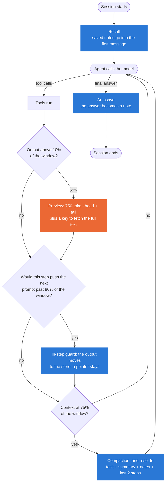
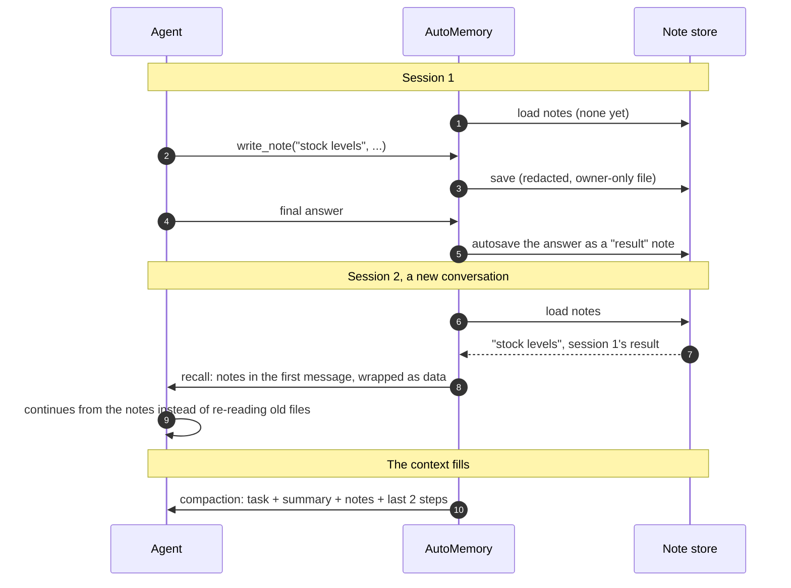
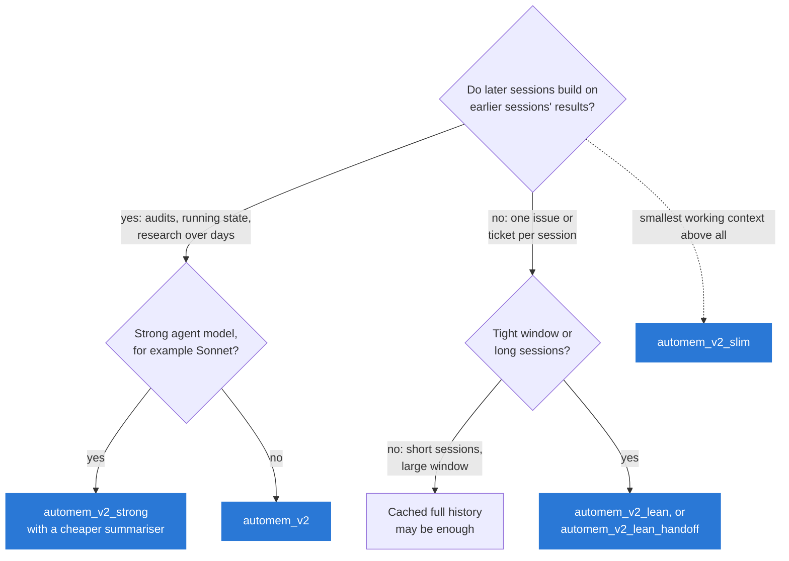
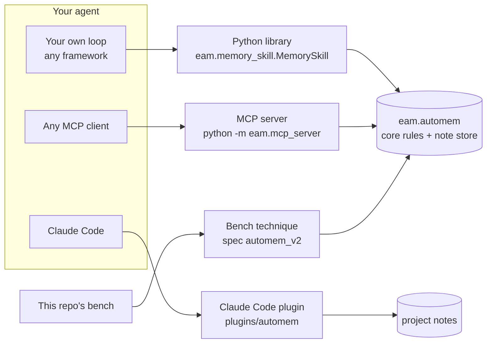
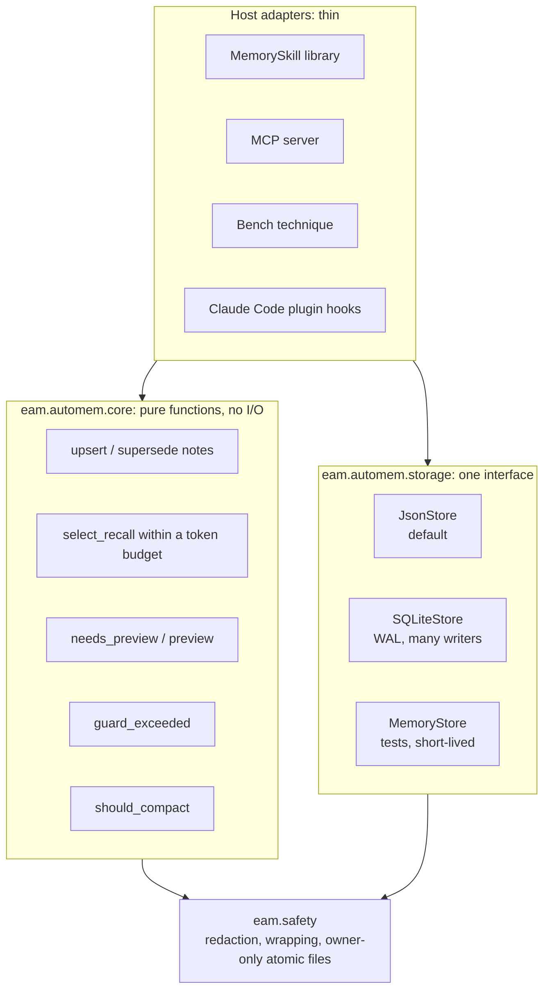

# AutoMemory v2

AutoMemory v2 is this repo's memory layer for long-running LLM agents. It keeps the agent's context small and its
prompt cache intact, so a long task costs less and fails less often at the context window. It also gives the agent
notes that carry over from one session to the next.

On four long multi-session tasks, `automem_v2` matches the accuracy of the unoptimised agent with its full window
(the "ceiling") at **85% of its cost on Claude Haiku and 58% on Claude Sonnet**, with a largest prompt about **a third**
of the ceiling's.

```text
spec:   automem_v2   =   automem:ingest=0.1
        (AutoMemory v1: notes, recall, autosave, in-step guard, compaction at 75% of the window)
      + (v2: large tool outputs enter as a head/tail preview, full text one call away)
```

**Contents:** [What it does](#what-it-does) · [The agent loop](#where-it-acts-in-the-agent-loop) ·
[Across sessions](#across-sessions) · [Components and sources](#components-and-their-sources) ·
[Results](#results) · [Presets](#the-v2-preset-family) · [How to use](#how-to-use) · [Settings](#settings) ·
[Architecture](#architecture) · [Security](#security) · [Paper references](#paper-references) ·
[Limits](#limits)

---

## What it does

An agent loop re-sends its whole history on every call. Three things go wrong as a task gets longer:

1. **The window fills.** Tool outputs (test logs, file reads, search results) pile up until the agent stops or loses
   track of the task.
2. **Nothing carries over.** Each new session starts from zero and repeats the exploration of the last one.
3. **Saving tokens the obvious way costs more.** Re-sent history that stays in the prompt cache is billed at 0.05–0.1×
   the input price. Trimming or summarising it every step breaks the cache, and the rewritten prompt is billed as a
   cache write at 1.25–2×. In this repo's measurements, methods that edit the history every step cost up to 6× the
   unoptimised agent.

AutoMemory v2 follows one design rule: **change the context only when an output arrives or at a rare reset, never by
rewriting cached history each step.** It acts at five points of the loop:

| When | What AutoMemory does |
|---|---|
| A session starts | Puts the saved notes into the first message (**recall**) |
| A tool output arrives | An output above 10% of the window enters as a 750-token head and tail, with a key to read the rest (**preview**, new in v2) |
| A step's outputs keep arriving | Any output that would push the next prompt past 90% of the window moves to a store, leaving a pointer (**in-step guard**) |
| The context reaches 75% of the window | One reset: a summary, the notes and the last two steps (**compaction**) |
| A session ends | The final answer is saved as a note, with no model call (**autosave**) |

---

## Where it acts in the agent loop



Blue steps come from v1, and the orange step is the v2 addition. Between resets, the history only grows by appending,
so every call reads the earlier prompt from the cache.

Over one long session the prompt climbs step by step while each call reads the earlier prompt from the cache. It drops
once, when it reaches 75% of the window, and climbs again from the reset. An agent without compaction runs into the
window instead; an agent that trims every step stays flatter but pays a cache write on every call.

---

## Across sessions

Notes are what make a multi-day job cheaper on the second day. A job here is something like an audit over several
rounds, stock kept across days, or research that grows a report.



Recall puts the notes in front of the agent rather than waiting for it to call `read_notes`. Haiku tended to re-read
old files instead of its notes, which cost it 0.65 in score against Sonnet on one task (0.34 against 0.99).

---

## Components and their sources

Every component is a switch, so each one can be turned off and measured against the full layer.

| Component | Switch | Default | Source | Why it is in (measured here) |
|---|---|---|---|---|
| Note workspace | `workspace` | on | FS-Researcher (USTC + Metastone, ACL'26); Manus's "file system as context" | With compaction, the only method that held up on both models across multi-session tasks. It beat MemoryOS, LightMem and Nemori by 0.2–0.5 in score. |
| Recall | `recall` | on | this repo | Haiku ignored notes it had to fetch itself (0.34 against Sonnet's 0.99). |
| Autosave | `autosave` | on | this repo | What a later session most often needs is an earlier session's answer. It costs no model call. |
| **Previews at ingestion (v2)** | `ingest=0.1` | 10% of the window | AWS Strands harness (`head_tail` preview, `retrieve_context`) | Haiku fully solved 11 of 16 runs against 7 of 16 for v1, at the same cost. Sonnet was 11 points cheaper. |
| In-step guard | `guard=0.9` | 90% of the window | this repo, built on Manus's offload rule | One Haiku step of parallel calls added 13–18K tokens and overflowed before any between-call check could act. |
| Compaction | `compact=resum` | ReSum at 75% | ReSum (Alibaba Tongyi Lab) | Without it, scores fell to 0.04–0.62. One rare reset keeps the cache alive for the rest of the session. |
| Keep recent steps | `keep_recent=2` | last 2 steps | the way Claude Code compacts | Left with only the summary, Haiku's tool-call replies degenerated. |
| Cheaper summariser | `--aux-model` / `#aux=` | the run's auxiliary model | this repo | Summary calls were about 40% of the cost on Sonnet; Haiku summarises for Sonnet at full accuracy. |
| Memory wrapping | `wrap` | on in the library, MCP server and plugin | this repo ([`SECURITY.md`](../SECURITY.md)) | Haiku obeyed 4 of 20 instructions planted in its notes when they arrived as plain text, and none when they were wrapped. |

Optional compactors replace ReSum through `compact=`:

| `compact=` | Method | Source | Note |
|---|---|---|---|
| `resum` | ReSum summary (default) | Alibaba Tongyi Lab | Official prompts |
| `handoff` / `handoff_aux` | EoCC handoff recap: objective, facts, changes made, verification, dead ends, next command | NVIDIA | Written by the agent itself (`handoff`), so the history is read from the cache, or by the summariser (`handoff_aux`) |
| `sjc` | ReSum summary pruned by a source judge: lines no tool output supports are dropped | University of Virginia | Used by `automem_v2_strong` |
| `openclaw`, `openclaw+sjc` | OpenClaw's structured summary, optionally pruned by SJC | SJC's host compressor | |
| `mask` | Observation masking: keep only the latest tool results | "The Complexity Trap" (NeurIPS'25 workshop) | The only single-session method that recovered on Haiku |
| `none` | No compaction | | For short tasks only |

`fold=true` adds ReFold's de-duplication and folding of finished steps (UC Santa Barbara + Intel). That is the
`automem_v2_slim` preset.

---

## Results

Four long synthetic tasks on the Claude Code CLI route, at list prices with prompt caching on. Each cell gives score
(0–1), cost against the ceiling, runs in which every session was fully solved, and largest prompt against the
ceiling's.

| Method | Claude Haiku | Claude Sonnet |
|---|---|---|
| No memory (floor) | 0.21 · 27% · 1/16 · 34% | 0.17 · 38% · 1/16 · 48% |
| Unoptimised agent, full window (ceiling) | 0.88 · 100% · 9/16 · 100% | 0.95 · 100% · 12/16 · 100% |
| Note workspace + ReSum (best pairing of published methods) | 0.89 · 126% · 11/16 · 40% | 0.94 · 75% · 8/10 · 42% |
| AutoMemory v1 | 0.83 · 86% · 7/16 · 34% | 0.98 · 68% · 14/16 · 36% |
| **AutoMemory v2** (`automem_v2`) | **0.88 · 85% · 11/16 · 35%** | **0.99 · 58% · 13/16 · 37%** |
| AutoMemory v2 strong (`automem_v2_strong`) | 0.81 · 114% · 7/16 · 35% | 1.00 · 61% · 16/16 · 37% |
| AutoMemory v2 slim (`automem_v2_slim`) | 0.87 · 90% · 6/16 · 30% | 1.00 · 80% · 7/8 · 30% |

| Task | Sessions | Window | Work |
|---|---|---|---|
| `research_corpus` | 1 | 40K | multi-hop research over 130 documents |
| `ops_stream` | 10 | 32K | stock keeping with corrections across sessions |
| `ledger_audit` | 3 | 48K | data larger than the window |
| `repo_debug` | 2 | 16K | debugging a generated library with real `pytest` |

**Re-checked.** A same-day re-run (12 Nov 2026) gave 0.75 and 0.86 at 87% and 74% of the ceiling's cost on Haiku
(ceiling 0.80), and 0.99 and 1.00 at 56% on Sonnet (ceiling 0.95). Run-to-run spread on these tasks is up to 0.11 in
score, so smaller differences are noise.

**Real repositories.** On SWE-bench Verified (100 Django issues, a 16K window, three runs), the no-notes variant
`automem_v2_lean` resolves as many issues as the ceiling with its full window, at 80% of its cost on Sonnet (95%
interval 72–90%) and the same cost on Haiku. In a failure audit of those runs, only 4 of 48 lost issues traced back to
the memory mechanism; 33 were run-to-run variation and 10 were wrong fixes by an agent that had what it needed.

Full method: [`methodology.md`](methodology.md). Full tables: the main [README](../README.md#results).

---

## The v2 preset family



| Preset | Spec | Use it for |
|---|---|---|
| `automem_v2` | `automem:ingest=0.1` | **The default.** Multi-session work that builds on earlier results |
| `automem_v2_strong` | `automem:ingest=0.1,compact=sjc` | Strong agent models, with a cheaper summariser (`#aux=`). It lowered two tasks on Haiku. |
| `automem_v2_slim` | `automem:ingest=0.1,fold=true` | The smallest working context, at a little more cost |
| `automem_v2_lean` | `automem:workspace=false,ingest=0.1` | Coding issues or tickets, one per session |
| `automem_v2_lean_handoff` | `automem:workspace=false,ingest=0.1,compact=handoff,handoff_variant=swe` | The same, with NVIDIA's handoff recap at resets (level with `automem_v2_lean` over three runs) |
| `automem_v2_adaptive` | `automem:workspace=adaptive,ingest=0.1` | An unknown workload on a strong model: the summariser decides per session whether to keep notes |

When unsure, pick `automem_v2`. Taking notes on unrelated coding issues cost up to 90 points of cost on Haiku and
nothing on Sonnet. The opposite mistake, no notes on work that builds across sessions, cost 100–160 points and about
0.1 in score.

---

## How to use

AutoMemory v2 comes in four forms with the same rules. The core needs only the Python standard library (3.10+).



### 1. In your own agent loop (Python library)

```python
from eam.memory_skill import MemorySkill

skill = MemorySkill("~/.eam-memory/my-project",
                    window=200_000,          # your model's context window
                    preview=0.1,             # v2: outputs above 10% of the window enter as head + tail
                    summarize=cheap_llm)     # a cheaper model for the compaction summary

messages = [{"role": "system", "content": BASE_SYSTEM + "\n\n" + skill.system_addendum()},
            {"role": "user", "content": skill.session_preamble() + task}]   # recall
tools = my_tools + skill.tool_specs()        # write_note, read_notes, read_artifact

while True:
    reply, usage = llm(messages, tools)      # usage.prompt_tokens: the real size of this prompt
    if done(reply):
        skill.save_session(reply.text)       # autosave
        break
    skill.start_step(usage.prompt_tokens, reply.text)
    for call in reply.tool_calls:
        if call.name in {"write_note", "read_notes", "read_artifact"}:
            out = skill.call_tool(call.name, call.args)
        else:
            out = skill.ingest_tool_output(call.name, run_tool(call))     # preview + in-step guard
        messages.append(tool_message(call, out))
    messages = skill.maybe_compact(messages, context_tokens=skill.end_step(), question=task)   # rare reset
```

Options:
- **NVIDIA's handoff recap** in place of the ReSum summary: `MemorySkill(..., compaction="handoff")`, then
  `handoff_prompt()` and `apply_handoff()` (the full loop is in [`automem.md`](automem.md)).
- **Typed notes:** `skill.write_note("cache fix", text, type="decision", files=["utils/cache.py"], supersedes="cache plan")`.
  The superseded note is no longer recalled. The types are `fact`, `decision`, `dead_end`, `command`, `result`,
  `handoff` and `note`.
- **Storage:** JSON files by default, `MemorySkill(store=SQLiteStore("~/.eam-memory/app.db"))` for many notes or
  concurrent writers, or `MemoryStore()` for short-lived agents (all in `eam.automem`).

### 2. In Claude Code (plugin)

```bash
claude --plugin-dir plugins/automem
```

| Hook | What it does |
|---|---|
| `SessionStart` | Recalls this project's notes at startup, resume, `/clear` and after compaction |
| `PostToolUse` (Bash) | Long output reaches the model as head and tail, including the tail Claude Code's own preview cuts off |
| `PreCompact` | Compaction keeps NVIDIA's six-field handoff recap |
| `Stop` | Saves each turn's final message as a project note |

The plugin makes no extra model calls and leaves your permission rules alone. Inside Claude Code it was neutral in
the pilots (same accuracy, cost within ±10%), because Claude Code already caches, compacts and saves long outputs.
The layer pays off most in agents without those built-ins and in multi-session work.

### 3. From any MCP client (MCP server)

```json
{"mcpServers": {"automem": {"command": "python", "args": ["-m", "eam.mcp_server"],
                            "env": {"EAM_MEMORY_DIR": "/path/to/project-memory", "EAM_MEMORY_WINDOW": "200000"}}}}
```

Tools: `recall` (call first in each session), `write_note`, `read_notes`, `save_session`, `offload`, `read_artifact`,
`context_budget`, `compact` and `handoff`. An MCP server cannot rewrite its client's context, so the client applies
resets itself.

### 4. On this repo's bench

```bash
python -m eam.bench run --task ops_stream -t automem_v2 -t naive@native \
    --backend claude-cli --model cc-sonnet --aux-model cc-haiku --n 2
```

Ablate a component by spelling the preset out and changing one switch, for example `-t "automem:ingest=0.1,guard=0"`
or `-t "automem:ingest=0.1,recall=false"`.

---

## Settings

| Switch (bench spec) | Library argument | Default in v2 | Effect |
|---|---|---|---|
| `workspace` | (always on; use `automem_v2_lean` on the bench) | `true` | Note tools and the instruction to save results; `adaptive` decides per session |
| `recall` | `session_preamble()` | `true` | Notes go into the first message and back in after each reset |
| `autosave` | `save_session()` | `true` | Each session's answer is saved as a `result` note |
| `ingest` | `preview` | `0.1` | Outputs above this share of the window enter as head and tail (0 turns it off) |
| `ingest_preview` | `preview_tokens` | `750` | Size of the head and tail preview, in tokens |
| `guard` | `guard` | `0.9` | Share of the window a step may fill before outputs are moved out (0 turns it off) |
| `compact` | `compaction` | `resum` | `resum`, `handoff`, `handoff_aux`, `sjc`, `openclaw`, `openclaw+sjc`, `mask` or `none` |
| `trigger` | `trigger` | `0.75` | Share of the window at which the one reset happens |
| `keep_recent` | (fixed at 2) | `2` | Complete steps kept verbatim after a reset |
| `handoff_variant` | `handoff_variant` | `general` | `swe` for coding work, with the `handoff` compactors |
| `fold` | (bench only) | `false` | ReFold's de-duplication and folding (`automem_v2_slim`) |
| `wrap` | `wrap` | bench `false`, library `true` | Recalled notes are wrapped as data, with a rule never to follow instructions inside |
| | `recall_budget` | `0.1` | Recall takes at most this share of the window; older notes are listed by name |
| | `retention_days`, `max_artifact_mb` | `14`, `200` | Stored outputs are deleted after 14 days or beyond 200 MB per project |

---

## Architecture



- **Core** holds the measured rules as pure functions, so the library, the MCP server and later adapters share one
  tested implementation.
- **Storage** sits behind one interface with a conformance test suite. A graph or vector store would plug in here.
- **Notes** are typed records (schema version 2). Version 1 files are read as they are and rewritten on the next write.
- **Lightweight by test:** no runtime dependencies in the core, under 5 ms added per step, and the memory wrapper takes
  under 2% of a 16K window (`tests/test_lightweight.py`).

---

## Security

What AutoMemory keeps between sessions is an attack surface: an instruction saved from a web page could be obeyed in
a later session. Version 0.2.0 closed this off:

- Recalled notes, summaries and recaps arrive inside a `<memory>` block marked as data, with escaped tags and a system
  rule never to follow instructions found there.
- Secrets are replaced with `[REDACTED:kind]` before anything is written: API keys, tokens, private keys, passwords in
  assignments and credentials in URLs.
- Files are owner-only and written atomically, notes are updated under a lock, and stored outputs expire after 14 days
  or beyond 200 MB.

Threat model and settings: [`SECURITY.md`](../SECURITY.md).

---

## Paper references

| Used for | Paper | Released | Lab | Link |
|---|---|---|---|---|
| Compaction (default) | ReSum: Unlocking Long-Horizon Search Intelligence via Context Summarization | 16 Sep 2025 | Alibaba Tongyi Lab | [arXiv 2509.13313](https://arxiv.org/abs/2509.13313) |
| Note workspace | FS-Researcher: Test-Time Scaling for Long-Horizon Research Tasks with File-System-Based Agents (ACL'26) | 2 Feb 2026 | USTC + Metastone | [arXiv 2602.01566](https://arxiv.org/abs/2602.01566) |
| Handoff recap (`compact=handoff`) | You don't need long context (EoCC) | 3 Nov 2026 | NVIDIA | [arXiv 2611.05306](https://arxiv.org/abs/2611.05306) |
| Source-judged summary (`compact=sjc`) | Prune the Summary, Not the History: Source-Judged Compaction for Long-Horizon Agents | 14 Oct 2026 | University of Virginia | [arXiv 2610.20927](https://arxiv.org/abs/2610.20927) |
| Folding (`fold=true`) | ReFold: Training-Free Reversible Inter-Turn Context Folding for Long-Horizon Agents | 6 Oct 2026 | UC Santa Barbara + Intel | [arXiv 2610.07863](https://arxiv.org/abs/2610.07863) |
| Masking (`compact=mask`) | The Complexity Trap: Simple Observation Masking Is as Efficient as LLM Summarization for Agent Context Management (NeurIPS'25 DL4Code) | 2025 | Lindenbauer et al. | NeurIPS'25 workshop |
| The cache lesson (not used, measured) | Reducing Cost of LLM Agents with Trajectory Reduction, AgentDiet (FSE'26) | 28 Sep 2025 | Peking University + ByteDance | [arXiv 2509.23586](https://arxiv.org/abs/2509.23586) |
| Long-term memory baselines it beat | Memory OS of AI Agent, MemoryOS (EMNLP'25); also LightMem (ICLR'26) and Nemori (ACL'26) | 30 May 2025 | BUPT + Tencent; ZJU; Fudan + Shanda | [arXiv 2506.06326](https://arxiv.org/abs/2506.06326) |

Non-paper sources:
- **AWS Strands harness** (`strands-harness` 0.3.3, Apache-2.0): the head and tail preview with `retrieve_context`,
  which became v2's preview step.
- **Manus, "Context Engineering for AI Agents":** the file system as context and offloading large outputs, behind the
  workspace and the in-step guard.
- **Claude Code's compaction:** keeping the latest steps after a reset.

Every method behind these components was measured on its own on the same bench before it went into AutoMemory; see
[`new_methods.md`](new_methods.md) and [`literature_review.md`](literature_review.md).

---

## Limits

- Measured on Claude Haiku and Claude Sonnet through the Claude Code CLI route, with tools emulated as text. Native tool
  calls on Bedrock and other model families are still to be tested.
- The four synthetic tasks are generated. Real-repository results cover Django and SymPy, both Python.
- Inside Claude Code, which already caches, compacts and saves long outputs, the plugin made no measurable difference.
- Sample sizes are 2–4 runs per cell on the synthetic tasks and 3 runs on 100 Django issues. Differences under about
  0.1 in score or 15 points in cost are within run-to-run noise.

Older guide for v1 and the full library loop: [`automem.md`](automem.md).
