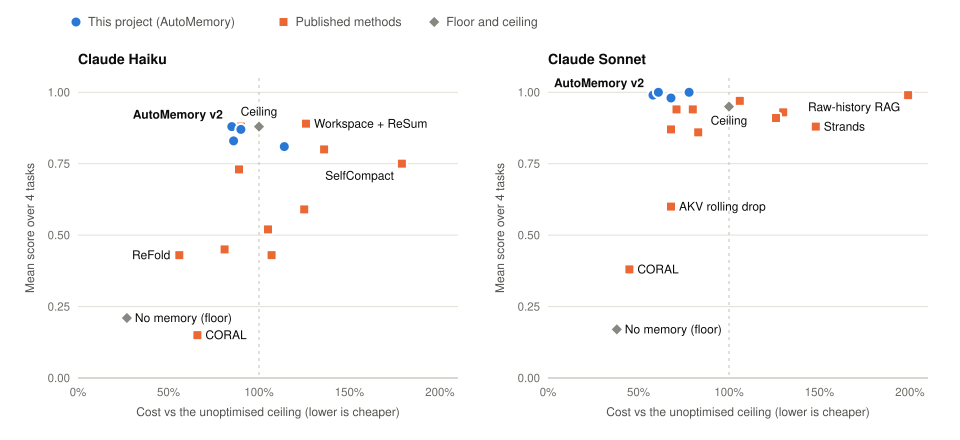
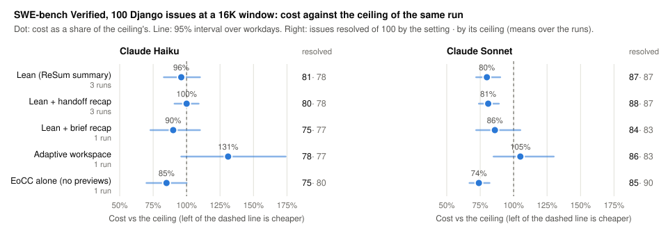
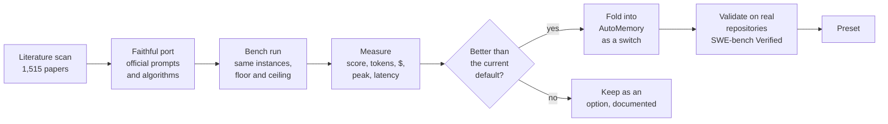
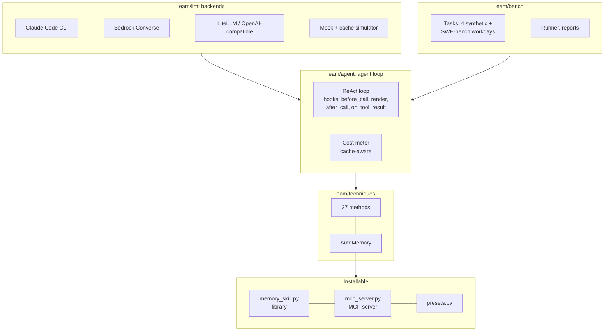

# Results, methods and validation

The full measurements behind AutoMemory: every method on the long synthetic tasks, SWE-bench Verified, the validation round, the Claude Code plugin pilots, and the list of methods and papers. How the measurement works is in [`methodology.md`](methodology.md); the practical guide is the [README](../README.md).

[Synthetic tasks](#four-long-synthetic-tasks) · [SWE-bench Verified](#real-repositories-swe-bench-verified) · [Validation round](#validation-round) · [What the results show](#what-the-results-show) · [Recall fixes](#recall-size-and-the-step-5-fixes) · [Claude Code plugin pilots](#claude-code-plugin-pilots) · [Methods tested](#methods-tested) · [How the research is run](#how-the-research-is-run) · [Open research items](#open-research-items)

## Overview

About **3,700 benchmark runs** on Claude Haiku and Claude Sonnet (Claude Code CLI route, list prices, prompt caching
on), measured up to 2026-11-12.

**Measurement** (details in [`docs/methodology.md`](methodology.md)):
- Each method sits between the same model's **floor** (`naive`: no memory, no caching, the task's window) and
  **ceiling** (`naive@native`: nothing removed, the model's own window, no caching), on the same task instances.
- **Cost** is relative to the ceiling's cost (60% means 40% cheaper). **Peak** is the largest prompt sent.
- Haiku 4 runs per cell, Sonnet 2–4. Measured run-to-run spread (the same setting twice on one day): up to 0.11 in
  mean score on the synthetic tasks; on 100 coding issues, 1–2 issues resolved and 7–38% in cost. Smaller differences
  are noise.

### Four long synthetic tasks

<picture>
  <source media="(prefers-color-scheme: dark)" srcset="assets/synthetic-frontier-dark.svg">
  
</picture>

Top left is best: the ceiling's accuracy at a fraction of its cost.

| Task | Sessions | Window | Work |
|---|---|---|---|
| `research_corpus` | 1 | 40K | multi-hop research over 130 documents |
| `ops_stream` | 10 | 32K | stock keeping with corrections across sessions |
| `ledger_audit` | 3 | 48K | data larger than the window |
| `repo_debug` | 2 | 16K | debugging a generated library with real `pytest` |

<b>Full table</b>: score · cost vs ceiling · runs fully solved · peak context vs ceiling

| Method | Developer | Haiku | Sonnet |
|---|---|---|---|
| No memory (floor) | — | 0.21 · 27% · 1/16 · 34% | 0.17 · 38% · 1/16 · 48% |
| Unoptimised ceiling | — | 0.88 · 100% · 9/16 · 100% | 0.95 · 100% · 12/16 · 100% |
| Workspace + ReSum (best phase-1 combination) | USTC / Alibaba Tongyi | 0.89 · 126% · 11/16 · 40% | 0.94 · 75% · 8/10 · 42% |
| MemoryOS / LightMem / Nemori + ReSum (3 tasks) | BUPT+Tencent / ZJU / Fudan+Shanda | 0.54–0.61 · 114–179% | — |
| Strands harness defaults | AWS | 0.59 · 125% · 7/16 · 35% | 0.88 · 160% · 4/8 · 43% |
| CADOC | SJTU | 0.43 · 107% · 5/16 · 44% | 0.86 · 86% · 4/8 · 40% |
| ReFold | UCSB + Intel | 0.43 · 56% · 3/16 · 41% | 0.97 · 108% · 7/8 · 38% |
| SJC on ReSum | University of Virginia | 0.80 · 136% · 7/16 · 42% | 0.94 · 81% · 7/8 · 40% |
| OpenClaw + SJC | University of Virginia | 0.88 · 90% · 10/16 · 39% | 0.87 · 69% · 5/8 · 39% |
| AKV rolling drop | Tsinghua + CUHK | 0.45 · 81% · 4/16 · 39% | 0.60 · 69% · 3/8 · 43% |
| Raw-history RAG (3 tasks) | Memory Tax studies | 0.52 · 105% · 1/12 · 41% | 0.99 · 213% · 4/6 · 48% |
| CORAL (prompting-only) | CUHK + Tencent + HKUST | 0.15 · 66% · 0/16 · 46% | 0.38 · 46% · 1/8 · 48% |
| SelfCompact | Apple + JHU | 0.75 · 179% · 6/16 · 38% | 0.93 · 134% · 6/8 · 30% |
| EoCC handoff compaction alone (`eocc`) | NVIDIA | 0.73 · 89% · 6/16 · 42% | 0.91 · 126% · 9/16 · 46% |
| AutoMemory v1 | this repo | 0.83 · 86% · 7/16 · 34% | 0.98 · 68% · 14/16 · 36% |
| **AutoMemory v2** (`automem_v2`) | this repo | **0.88 · 85% · 11/16** · 35% | 0.99 · **58%** · 13/16 · 37% |
| **AutoMemory v2 strong** (`automem_v2_strong`) | this repo | 0.81 · 114% · 7/16 · 35% | **1.00 · 61% · 16/16** · 37% |
| AutoMemory v2 slim (`automem_v2_slim`) | this repo | 0.87 · 90% · 6/16 · **30%** | 1.00 · 80% · 7/8 · **30%** |
| AutoMemory v2 + handoff recap (`compact=handoff`) | this repo + NVIDIA | 0.83 · 79% · 8/16 · 35% | 1.00 · 66% · 13/16 · 37% |
| … recap written by the Haiku summariser (`compact=handoff_aux`) | this repo + NVIDIA | — | 0.99 · 58% · 12/16 · 38% |

- On Sonnet, AutoMemory uses Haiku as its summariser.
- Cost and peak are relative to the ceiling on the same task instances (a method run on fewer instances is
  compared with the ceiling on those instances only).
- Same-day re-run of 2026-11-12 (instances 0–3, same formula): AutoMemory v2 scored 0.75 and 0.86 at 87% and 74%
  on Haiku (ceiling 0.80) and 0.99 and 1.00 at 56% on Sonnet (ceiling 0.95). Without the note workspace
  (`automem_v2_lean`) the same tasks scored 0.64 and 0.87 at 249% and 152%.
- Phase-1 methods tested on earlier tasks are left out: observation masking cost up to 608%, AgentDiet 410%, and
  turn control had no effect. Context-Folding solved Sonnet `research_corpus` at 20% but failed `ops_stream` and
  `ledger_audit`.

### Real repositories: SWE-bench Verified

Real issues from SWE-bench Verified in workdays of 5 consecutive sessions, one issue per session. Each session starts
from a fresh checkout at its issue's commit. Grading follows SWE-bench: the test files the issue's test patch touches
are run, and the issue is resolved iff every FAIL_TO_PASS and PASS_TO_PASS test passes. The memory settings work inside
a 16K window (compaction at 12K, after NVIDIA's "You don't need long context"); the ceiling keeps the full history in
the model's own window.

<picture>
  <source media="(prefers-color-scheme: dark)" srcset="assets/swe-16k-dark.svg">
  
</picture>

Issues resolved · cost vs the ceiling [95% interval over workdays]. Every cell is compared with a ceiling run on the
same day (2026-11-09 to 11-13). The first three rows are three runs each: mean issues resolved, costs pooled.

| Issue set | Setting | Haiku | Sonnet |
|---|---|---|---|
| **Django**, 100 issues, **three runs** | Ceiling: full history, own window | 78 · 100% | 87 · 100% |
| | `automem_v2_lean` | 81 · 96% [83–110] | 87 · **80%** [72–90] |
| | `automem_v2_lean_handoff` | 80 · 100% [91–109] | 88 · **81%** [74–89] |
| **Django**, the same issues, one run | Ceiling | 77 · 100% | 83 · 100% |
| | … brief recap (`handoff_variant=brief`) | 75 · 90% [73–110] | 84 · 86% [72–105] |
| | `automem_v2_adaptive` | 78 · 131% [96–174] | 86 · 105% [85–130] |
| **Django**, the same issues, one run | Ceiling | 80 · 100% | 90 · 100% |
| | EoCC alone (`eocc`): handoff recap, no previews | 75 · 85% [70–100] | 85 · 74% [67–82] |
| **Django, related issues**: each workday stays in one subsystem (80 issues Haiku, 50 Sonnet) | Ceiling | 64 · 100% | 44 · 100% |
| | `automem_v2_lean` | **70** · 117% [89–152] | 44 · 95% [66–126] |
| | `automem_v2` (with notes) | 64 · 208% [169–247] | 44 · 87% [69–113] |
| | `automem_v2_adaptive` | 67 · 106% [83–135] | 45 · 80% [60–104] |
| **SymPy**, a second repository (75 issues Haiku, 40 Sonnet) | Ceiling | 50 · 100% | 35 · 100% |
| | `automem_v2_lean` | 50 · 116% [81–158] | 35 · **70%** [54–109] |
| | `automem_v2_lean_handoff` | 52 · 92% [71–123] | 34 · 74% [56–108] |

- **Accuracy.** Inside a 16K window the lean settings resolve as many issues as the ceiling in every set. Paired by
  issue, no lean setting differs significantly from the ceiling or from another lean setting (sign test, p ≥ 0.07).
- **Cost.** On Sonnet, lean costs 80% of the ceiling over three Django runs (82%, 77% and 81% run by run) and is
  below it in the other two sets. On Haiku it cannot be told apart from the ceiling (92%, 110% and 89%).
- **EoCC alone is cheap but loses issues.** Without previews at ingestion, 22 (Haiku) and 19 (Sonnet) of 100 sessions
  filled the 16K window and were stopped. It resolved 5 fewer issues than its ceiling on both models (pooled: 2 gained,
  12 lost, p = 0.013), 8 of the 12 in stopped sessions, at 85% and 74% of the ceiling's cost.
- **Notes do not pay on coding issues**, even when consecutive issues touch the same subsystem: with the note
  workspace Haiku resolved 64 instead of 70 at almost twice the cost, and later sessions of a workday gained nothing.
- **Handoff recap or ReSum summary: level.** Over three Django runs the two resolve the same number of issues
  (Haiku 80 and 81, Sonnet 88 and 87) at the same cost (handoff at 104% [93–118] and 102% [94–111] of ReSum). The
  validation round's pooled 22 against 11 (p = 0.08) did not repeat: the two new runs gave 10 against 12.
- **Noise.** `automem_v2_lean` run twice on the same day resolved 80 and 81 (Haiku) and 85 and 87 (Sonnet), with 6–7
  issues flipping, and differed by 7% and 38% in cost. One run of 100 issues does not separate settings closer than
  about 5 issues or 25 points of cost. With the reply cap at 8K (the follow-up runs), two runs of one cell differed
  by 1–15% in cost.

<b>Earlier grid (2026-11-06)</b>: 32K and 16K windows, one run per cell · issues resolved of 100 · cost vs ceiling · $ per resolved issue

| Setting | Window | Haiku | Sonnet |
|---|---|---|---|
| Ceiling: full history, no cache | own | 82 · 100% · $0.015 | 88 · 100% · $0.165 |
| Full history, cached (no memory layer) | own | 79 · 86% · $0.013 | 86 · 84% · $0.142 |
| Full history, cached | 32K | 77 · **62%** · **$0.010** | 87 · 100% · $0.168 |
| AutoMemory v2 lean (`automem_v2_lean`) | 32K | 78 · 98% · $0.015 | 87 · 92% · $0.154 |
| AutoMemory v2 lean + handoff (`automem_v2_lean_handoff`) | 32K | 77 · 87% · $0.014 | **89 · 79% · $0.130** |
| EoCC alone (`eocc`) | 32K | 82 · 88% · $0.013 | 84 · 87% · $0.151 |
| AutoMemory v2 lean | 16K | 76 · 83% · $0.013 | 86 · **73% · $0.123** |
| **AutoMemory v2 lean + handoff** | 16K | **81** · 89% · $0.013 | **88** · 89% · $0.147 |
| … recap written by the Haiku summariser | 16K | — | 86 · 90% · $0.152 |
| … brief recap (`handoff_variant=brief`) | 16K | 78 · **79%** · **$0.012** | 84 · 77% · $0.133 |
| EoCC alone | 16K | 72 · 93% · $0.016 (15 overflows) | 83 · 100% · $0.175 (7 overflows) |

Read this grid with the validation round in mind:
- Sessions that ended early (overflow, step limit) were scored unresolved without grading their final state. This
  lowered the EoCC rows most: re-graded, EoCC alone at 16K resolves 77 of 100 on Haiku, not 72.
- Cells ran on different days and once each; the ceiling resolved 82 and 88 here and 77 and 83 when re-run.
- Cost differences between cells of less than about 25 points, and the dollar figures beyond two digits, are inside
  the run-to-run spread. The rankings "handoff costs more than ReSum" and "the brief recap is the cheapest" did not
  hold in the same-day runs.
- At 32K the window rarely binds (sessions peak at 16–21K; 3–9 compactions in 100 issues).

### Validation round

After the first results, four checks were run together (2026-11-08 to 11-12, 596 runs):

| Check | What it found |
|---|---|
| Same-day controls: every decision cell re-run on one day | The two headline results hold. Baselines drift between days (the ceiling: 82 → 77 and 88 → 83 issues), so cells from different days must not be compared closely. |
| Noise: one cell per workload run twice | The spread given under "Measurement" above. |
| Independent audit of the measurement code | 15 findings, 13 fixed. Two changed a published result: sessions that ended early were not graded, and a recap that exceeded the window was not counted as an overflow. |
| Out-of-sample tasks: SymPy, and Django workdays of related issues | The lean result holds on a second repository; notes do not pay on coding issues even when they are related. |

It also found a harness artifact. The bench emulates tools as text through the Claude Code CLI, and in about 1% of
calls the model loops until it reaches the output cap; the loop is billed and discarded. These runaway replies were
22% (Sonnet) and 26% (Haiku) of all measured cost in the round and explain most of the cost noise. The cap is now
8K tokens instead of 32K (a runaway reply costs about a quarter as much), cap hits are counted in every result row,
and each row records the CLI version and thinking settings it ran with.

Withdrawn: "handoff costs 6–16 points more than ReSum", "the brief recap is the cheapest per resolved issue",
"EoCC alone resolves the fewest issues", and dollar-per-issue rankings between the lean settings.

**Follow-up (2026-11-12 to 11-13, 280 runs).** The ceiling, lean and handoff cells were run twice more on the 100
Django issues, and EoCC alone was run next to its ceiling on both models, all with the 8K cap.

| Question | Answer |
|---|---|
| Is lean cheaper than the ceiling? | On Sonnet, yes: 80% [72–90] over three runs. On Haiku, no: 96% [83–110]. |
| Does the handoff recap resolve more issues than a ReSum summary? | Not confirmed. Same accuracy and same cost over three runs. |
| Does EoCC alone resolve fewer issues? | Yes, under the corrected grading too: 75 against 80 (Haiku) and 85 against 90 (Sonnet), because one session in five runs out of window. The withdrawn claim is reinstated in this form. |
| Did the 8K cap reduce the cost noise? | Yes. Two runs of one cell now differ by 1–15% in cost, against 7% and 38% before. |

### What the results show

1. **Fewer tokens is not fewer dollars.** Methods that edit history every step cost more than they save: AKV
   rolling drop on Sonnet `research_corpus` costs 93% when it drops every turn and 22% when it drops in blocks of 8,
   at the same score.
2. **Let the harness do the remembering.** Previews at ingestion, automatic recall and compaction at a fixed trigger
   held up on both models. Methods that need the model to manage its own memory failed on the weaker one: CORAL's
   tools were barely used, ReFold's Haiku recovery was 0.25.
3. **Plain notes beat engineered memory systems.** MemoryOS, LightMem and Nemori scored 0.2–0.5 lower than a note
   workspace with the same compaction.
4. **On coding work, a 16K window with compaction is enough, and the kind of summary matters little.** The lean
   settings resolve as many issues as the full-history ceiling on two repositories. NVIDIA's handoff recap (applied
   changes, dead ends, the next command) and a ReSum summary were level in accuracy and cost over three runs. What
   matters more is trimming at ingestion: the recap alone, without previews, lost 5 issues in 100.
5. **Match the memory layer to the work.** The note workspace is essential when sessions build on earlier results
   (without it: 0.64 and 0.87 in score at 1.5–2.5 times the ceiling's cost) and overhead on coding issues, even
   related ones (Haiku: twice the ceiling's cost, fewer issues resolved).
6. **Measure the noise before ranking.** The same setting run twice differed by up to 38% in cost, and about a
   quarter of all cost was a harness artifact. Four early rankings did not survive a same-day re-run; three runs
   per cell were needed to establish the one cost result that did (lean on Sonnet).

## Recall size and the step 5 fixes

**Step 4** traced AutoMemory on the multi-session tasks to see whether recalled notes are worth their tokens. By days
8–10 of the ten-day `ops_stream` job the notes took 26–29% of Sonnet's prompt, mostly stale autosaved copies of
earlier sessions' answers. Haiku's notes missed many facts later sessions needed, so it re-opened old files instead.

**Step 5** tested three fixes that add no model call, each against a baseline from the same day (118 runs):

| Fix | Result | Decision |
|---|---|---|
| Recall only the newest autosaved answer | `ops_stream`: Sonnet's notes 26% → 16% of the prompt at 95% of the cost, 99% of needed facts carried; Haiku cost 82% of baseline, needed facts carried 73% → 82%, fewer old files re-opened. Three-round audit: within noise | Default in the library and the note-keeping presets |
| Ids in notes (`note_ids`) | Fewer re-reads on Haiku; no gain in score or cost; Sonnet cost 26% more on the audit task | Off by default |
| Send a final answer back once while the last test run still fails (`verify`) | Haiku, 9 runs of 5 workdays: 157 issues resolved against 147, 39 won and 29 lost (sign test p = 0.27), at 95% of the cost; the check fired 58 times. Sonnet, 3 runs: 30 against 31 | Off by default; worth trying on smaller models |

## Claude Code plugin pilots

The plugin (`plugins/automem`) runs the measured harness steps as Claude Code hooks.

**Pilot inside Claude Code** (headless Claude Code with its own tools, 20 SWE-bench Verified issues per model, same
prompt and spending cap, with and without the plugin):

| | Resolved | Cost | Long outputs previewed |
|---|---|---|---|
| Haiku: plain / plugin | 16 / 16 | $0.115 / $0.121 (+5%) | — / 3 |
| Sonnet: plain / plugin | 15 / 16 | $1.288 / $1.153 (−10%) | — / 0 |

The plugin is neutral on short sessions: same accuracy, cost within ±10%, no errors. Claude Code solved most issues in
4–6 turns with prompts of 37–41K tokens (mostly its own instructions), so long outputs were rare; Sonnet's 10% saving
came with no preview fired and is run-to-run variation.

**Long sessions** (one Claude Code session per 12 issues, compaction at 100K tokens, 3 sessions per model and setting;
a fresh session per issue on the same 36 issues as the control):

| | Fresh session per issue | One long session | One long session + plugin |
|---|---|---|---|
| Haiku: resolved · $ per issue | 32/36 · $0.0073 | 30/36 · $0.0093 | 29/36 · $0.0089 |
| Sonnet: resolved · $ per issue | 31/36 · $0.0658 | 32/36 · $0.0706 | 33/36 · $0.0716 |

Here the plugin acted (compaction fired 4–11 times per model with its handoff recap; 8 long outputs previewed) and
still made no difference (−4% and +1% cost, within one issue). Claude Code already caches prompts, compacts, saves long
outputs, and its agent filters test logs itself (`| tail`, `| grep FAIL`), so these memory steps find little left to
do. A fresh session per unrelated task was 7–27% cheaper per issue than one long session. The plugin stays a safe,
optional add-on; the memory layer pays off in agents without these built-ins and in multi-session work (section above).

## Methods tested

Every technique follows its official code or prompts where they exist, and each module's docstring lists its
deviations. Each carries a provenance label (official, ported, baseline, provisional) in
[`eam/techniques/registry.py`](../eam/techniques/registry.py).

| Family | Methods (spec) | Source |
|---|---|---|
| Compaction | ReSum (`resum`), SJC + OpenClaw (`sjc`, `openclaw`), SelfCompact (`selfcompact`), **EoCC handoff** (`eocc`) | Alibaba Tongyi, UVA, Apple + JHU, NVIDIA |
| History editing | Observation masking (`obs_mask`), AgentDiet (`agentdiet`), AKV rolling drop (`akv_drop`), ReFold (`refold`), CADOC (`cadoc`) | NeurIPS'25 DL4Code, PKU + ByteDance, Tsinghua + CUHK, UCSB + Intel, SJTU |
| Ingestion | Strands harness defaults (`strands`), tool-result offload (`offload`) | AWS, Manus rules |
| Sub-agents and loops | Context-Folding (`folding`), turn control (`turn_control`), CORAL (`coral`) | ByteDance Seed, ByteDance, CUHK + Tencent + HKUST |
| Long-term memory | Note workspace (`fs_workspace`), raw-history RAG (`raw_rag`), MemoryOS / LightMem / Nemori (`ext_memory`) | USTC, Memory Tax studies, BUPT + Tencent, ZJU, Fudan + Shanda |
| This project | AutoMemory v1/v2 (`automem`, presets) | — |

### Top papers by lab region

The five papers from each region that shaped AutoMemory or the repo's conclusions most, ranked. **Released** is the
date of the first arXiv version. Results are score (0–1) and cost as a share of the ceiling's cost on the four synthetic
tasks, Haiku then Sonnet.

**Chinese labs**

| # | Paper | Released | Lab | How the repo uses it | What we measured |
|---|---|---|---|---|---|
| 1 | ReSum ([2509.13313](https://arxiv.org/abs/2509.13313)) | 16 Sep 2025 | Alibaba Tongyi Lab | AutoMemory's default compaction: one summary at 75% of the window | Workspace + ReSum was the best first-round pairing: 0.89 · 126%, 0.94 · 75% |
| 2 | FS-Researcher ([2602.01566](https://arxiv.org/abs/2602.01566), ACL'26) | 2 Feb 2026 | USTC + Metastone | AutoMemory's note workspace: notes outlive the conversation | Beat MemoryOS, LightMem and Nemori by 0.2–0.5 in score |
| 3 | AgentDiet ([2509.23586](https://arxiv.org/abs/2509.23586), FSE'26) | 28 Sep 2025 | Peking University + ByteDance | Ported verbatim; trims the trajectory every step | Cost up to 410%: rewriting history breaks the cache (the core lesson) |
| 4 | MemoryOS ([2506.06326](https://arxiv.org/abs/2506.06326), EMNLP'25) | 30 May 2025 | BUPT + Tencent | Long-term memory baseline, run from its own package with LightMem and Nemori | The three scored 0.54–0.61 at 114–179% on Haiku |
| 5 | CADOC ([2609.37012](https://arxiv.org/abs/2609.37012)) | 29 Sep 2026 | Shanghai Jiao Tong University | Re-implemented; cache-aware object cards | 0.43 · 107%, 0.86 · 86% |

**US labs**

| # | Paper | Released | Lab | How the repo uses it | What we measured |
|---|---|---|---|---|---|
| 1 | EoCC, "You don't need long context" ([2611.05306](https://arxiv.org/abs/2611.05306)) | 3 Nov 2026 | NVIDIA | AutoMemory's handoff recap (`compact=handoff`), prompts verbatim | With AutoMemory: 0.83 · 79%, 1.00 · 66%; alone it lost 5 Django issues (no previews) |
| 2 | Source-Judged Compaction ([2610.20927](https://arxiv.org/abs/2610.20927)) | 14 Oct 2026 | University of Virginia | AutoMemory option `compact=sjc`: drops summary lines no tool output supports | OpenClaw + SJC: 0.88 · 90%, 0.87 · 69% |
| 3 | SelfCompact ([2606.23525](https://arxiv.org/abs/2606.23525), NeurIPS'26) | 22 Jun 2026 | Apple + Johns Hopkins | Ported from the official code; the agent writes its own summary | 0.75 · 179%, 0.93 · 134% |
| 4 | ReFold ([2610.07863](https://arxiv.org/abs/2610.07863)) | 6 Oct 2026 | UC Santa Barbara + Intel | Official engine vendored; reversible folding | 0.43 · 56%, 0.97 · 108% |
| 5 | Memory Tax ([2610.34073](https://arxiv.org/abs/2610.34073)) | 25 Oct 2026 | UIUC-led, with Renmin University | Raw-history retrieval as a memory baseline | 0.52 · 105%, 0.99 · 213% (three tasks) |

AWS's Strands harness and Manus's context-engineering guide also shaped AutoMemory but are not papers.

Literature: a sweep of 1,515 arXiv papers ([`docs/literature/2026-11-scan/`](literature/2026-11-scan/)), a
verified list of papers ([`docs/literature_review.md`](literature_review.md)) and deep-reading notes
([`docs/papers/`](papers/)).

## How the research is run

## Open research items

| Item | Status | Cost | Why it matters |
|---|---|---|---|
| Three runs of the SymPy and related-issue sets | Next | ≈ $45 | Lean's saving on Sonnet is established on Django only; on these sets each cell ran once and the intervals are wide. |
| Cost on two price bases | Next | no API cost | List prices with caching (Bedrock and the CLI) and context-length pricing (self-hosted and long-context tiers) can rank methods differently. |
| Adapters for agents without built-in caching and compaction | Built; savings not yet measured there | no API cost to build | Adapters for the Claude API, Claude Agent SDK, LangGraph and OpenAI Agents SDK pass an offline conformance suite ([docs/adapters.md](adapters.md)). Measuring their savings with real models needs API keys. |
| Bedrock validation and native tool calls | Blocked: AWS credentials | — | Every result uses Claude Code CLI list prices and tools emulated as text; native tool calls remove the runaway replies at the source. Runbook: `scripts/run_bedrock_validation.sh`. |
| GPT and other non-Claude models | Blocked: API credentials | — | No non-Claude model has been measured. |
| Codex / OpenAI re-pricing | Not started | no API cost | Automatic caching at other prices may change which methods pay off. |
| A repository outside Python | Not started | — | Both SWE-bench repositories (Django, SymPy) are Python. |

## Limitations of these measurements

- All runs use the Claude Code CLI route at list prices, with tools emulated as text. That route produced the
  runaway replies described under [Validation round](#validation-round). Bedrock (native tool calls) and other
  price bases are on the [roadmap](#open-research-items).
- The synthetic tasks emulate small windows to create memory pressure.
- The SWE-bench sets are two Python repositories (Django, SymPy). Sonnet's out-of-sample sets are smaller (40–50
  issues). Only the ceiling, lean and handoff cells on Django were run three times; the other cells once.
- Rows recorded before 2026-11-12 ran with a 32K output cap and do not record the CLI version or thinking settings.
